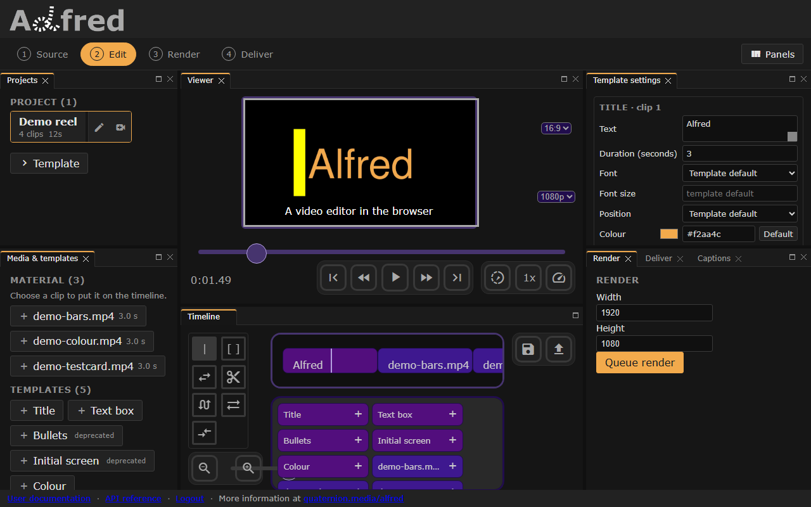

# alfred



*The editor at Edit, with a demo project open and its first caption over the picture.*

> *"Drama is life with all the dull bits cut out."*
>
> ~ Alfred Hitchcock

Alfred is a video editor that runs in the browser, designed for quick editing
from anywhere, including mobile devices. The browser edits the timeline; every
preview and every render is made by an Alfred server, which you run yourself,
with cloud storage optional.

Demo at [alfred.quaternion.media](https://alfred.quaternion.media)

## Shape

A small **control plane** (`alfred/`) orchestrating two cooperating engines,
side by side: **otto** draws the picture (the render engine, published
separately as `al-otto`, vendored at `alfred/otto`), and **vox** carries the
sound (QM's audio-engine seam, vendored at `alfred/vox`, which drives an
engine such as joe over HTTP). The control plane owns auth, project, render
and caption lifecycle, and orchestration; it does not touch media itself.
Every frame, render and timeline sound is otto's, and so is what a library
file holds, the demo clips and what a render's quality means to the encoder:
alfred calls the engines and imports no media library, and runs no ffmpeg.
`website/` is a mithril SPA built with parcel.

Captions -- typed, imported from SubRip, WebVTT or JSON, or transcribed from
the timeline's own sound by the audio engine -- are drawn into renders by
otto: [docs/captions.md](docs/captions.md), which also says how to point alfred
at joe.

The project is governed by the [Quaternion Media
constitution](https://github.com/quaternionmedia/qm), vendored at
`governance/qm`. Start at [AGENTS.md](AGENTS.md) — it is the entry point for
contributors and coding agents alike, and it names the project's known
governance gaps.

## Clone

```sh
git clone --recurse-submodules https://github.com/quaternionmedia/alfred.git
cd alfred
./al init          # install website dependencies
```

Already cloned without submodules:

```sh
git submodule update --init --recursive
```

On Windows, `CLAUDE.md` and `.github/copilot-instructions.md` are symlinks;
see [AGENTS.md](AGENTS.md) for the one-time `core.symlinks` step.

## Common commands

Everything routes through `./al`. Run it with no arguments for the full list.

| Command | What it does |
|---|---|
| `./al init` | Install website dependencies |
| `./al dev` | Run the dev stack; app on http://localhost:8000 (`ALFRED_PORT` to move it) |
| `./al dev --build` | Rebuild images first |
| `./al stop` | Stop the dev stack |
| `./al demo` | Download demo media into `videos/` (needs network; the app can generate its own) |
| `./al pytest` | API test suite, in Docker |
| `./al test` | End-to-end suite (Playwright), in Docker |
| `./al nox -s lint` | Ruff |
| `./al nox -s blacken` | Black (`-S`) |
| `./al docs` | Serve the docs locally on :4000 |
| `./al prod` | Production stack; expects a running traefik and the production `ALFRED_SECRET_KEY` exported |
| `./al flower` | Celery monitoring on :5555; needs the dev stack for its broker |
| `./al cookbook` | Regenerate `docs/cookbook.md` from the e2e specs |
| `./al recipes` | Record the `@recipe` walkthroughs against a running stack, write their stubs into `docs/recipes/`, and regenerate the cookbook |
| `./al install <pkg>` | Add a website dependency |
| `./al family` | alfred with otto, vox, joe, qmcp and the rest: status, quick suites, the stack wired to joe, a live check ([docs/family.md](docs/family.md)) |

`./al dev` publishes on 8000, 8001 and 27017, on `127.0.0.1` only. If
something already holds one, override it rather than fighting for it —
`ALFRED_PORT=8100 ./al dev`, and `ALFRED_DB_PORT` / `ALFRED_HMR_PORT` for the
others. `./al dev` refuses to start on an occupied port and names what has it,
because the failure this prevents is silent: the host port answers whoever
bound it first, so the stack comes up healthy while every request from your
machine reaches somebody else's application.

To try the app from a phone on the same network, `ALFRED_BIND=0.0.0.0 ./al
dev` publishes it on every interface for that run. Loopback is the default
because the dev stack trusts its callers: with `ALFRED_DEV_SKIP_AUTH=1`,
anyone who can reach it is a superuser. The database stays on loopback either
way. See the dev-server notes in [AGENTS.md](AGENTS.md).

## First run

There is nothing to download. Open the app, go to the **Source** stage, and
press *Generate a demo project* and *Generate demo media* — both are made
locally, the media by the engine from ffmpeg's own test sources, so a first run
needs no network access. `./al demo` still fetches the original sample footage
from a cloud bucket if you want it.

To work without logging in, `ALFRED_DEV_SKIP_AUTH=1 ./al dev` serves every
request as a fixed superuser and skips the login screen. It refuses to start
alongside `ALFRED_PRODUCTION` and prints a banner on every boot — see
[docs/dev-auth.md](docs/dev-auth.md).

## Tests

```sh
./al pytest                       # API suite, plus black and ruff, in Docker
./al test                         # browser suite, in Docker, on a stack it builds

pdm install -G test               # or on the host: Python deps and test extras
pdm run pytest                    # unit + pipeline suite
pdm run pytest -m "not needs_ffmpeg and not needs_db"   # no external tools

cd website && yarn install        # yarn: website/yarn.lock is the lockfile
npx playwright install chromium
yarn e2e                          # end-to-end, against a running ./al dev
```

On the host, `pdm install` takes `al-otto` from `alfred/otto` as a copy
rather than editable, and has no vox at all. `pip install -e alfred/otto
--no-deps` and `pip install -e alfred/vox --no-deps` in that environment make
the suite test the vendored engines the image runs, which
`tests/unit/test_stack_config.py` checks; `pdm install -G render` adds the
engine's render extra (gizeh), which its text templates draw with.

Strategy and known gaps: [tests/README.md](tests/README.md) for the backend,
[website/e2e/README.md](website/e2e/README.md) for the browser suite. Both
list what is *not* covered, deliberately.

The end-to-end suite is also the cookbook: [docs/cookbook.md](docs/cookbook.md)
is generated from it by `./al cookbook`, so every recipe in the documentation
is a test that runs. Prose describing behaviour goes stale silently; a test
describing behaviour goes red. `./al recipes` records the `@recipe`
walkthroughs: the recordings stay on your machine, and the SVG stub written
beside each, which the cookbook shows until a polished recording replaces it,
is committed.

## Documentation

Built with [mkdocs](https://www.mkdocs.org/):

```sh
./al docs                         # serves on :4000
```

## Contributing

[CONTRIBUTING.md](CONTRIBUTING.md) covers the workflow, what CI checks, and the
two rules that are easy to break by accident: everything arrives as a pull
request, and contributor fields name humans.

## Versioning

`alfred/_version.py` is the source of truth; `website/package.json` tracks it.
See [CHANGELOG.md](CHANGELOG.md).
