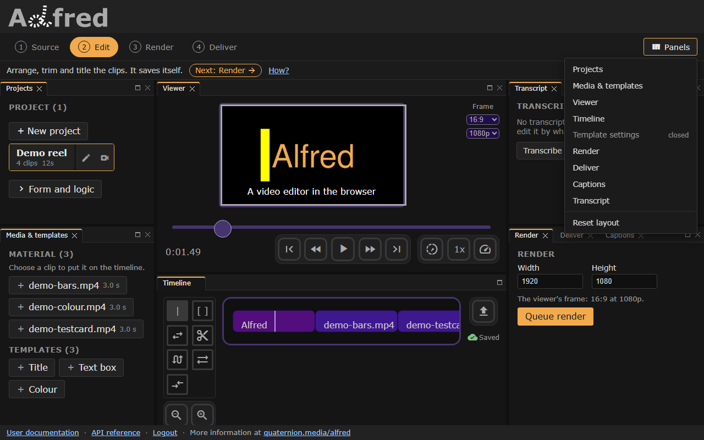

# Concepts

*The workspace and its Panels menu, which brings back a closed panel or resets the layout.*

What a request to alfred carries. Alfred needs no video experience, but these
help, and the [examples](../examples/index.md) send each of them.

- **[Concepts](concepts.md)**: a timeline of clips, a template, a project and a
  render, and which part of each is otto's.
- **[Template](template.md)**: the templates this server offers, and what
  their `data` adds to otto's.
- **[Project](project.md)**: a saved timeline, or one built from a form.
- **[Render](render.md)**: every field a render request takes.

The fields of a clip and a timeline are otto's: [otto's timeline
page](https://github.com/quaternionmedia/otto/blob/51a1b0eb1d53d99f3ae55083406901ed1255ec40/docs/timeline.md),
at the commit alfred runs.
