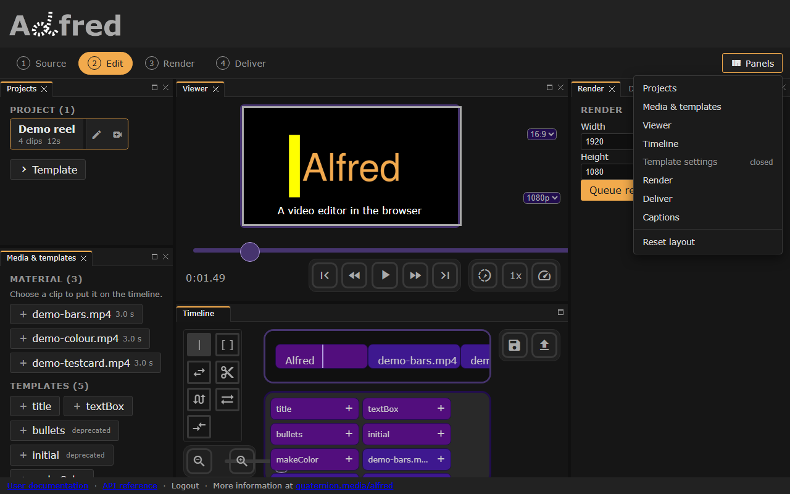

# About

*The workspace and its Panels menu, which brings back a closed panel or resets the layout.*

## [Concepts](concepts.md)
Alfred needs no video experience, but the [concepts of video editing](concepts.md) help.

## Design

Alfred has these components:

### website
: The browser tools to create and edit videos:
    
    - a "simple" single-track video editor
    - an "advanced" multi-track video editor
    - template rendering forms
    - a preview frame of the video
    - render status and downloads
### [API](../api/index.md)
: The video rendering components, as a backend service.

### Models
The properties each model takes:

#### [Clip](clip.md)
#### [Template](template.md)
#### [Edl](edl.md)
#### [Project](project.md)
#### [Render](render.md)
