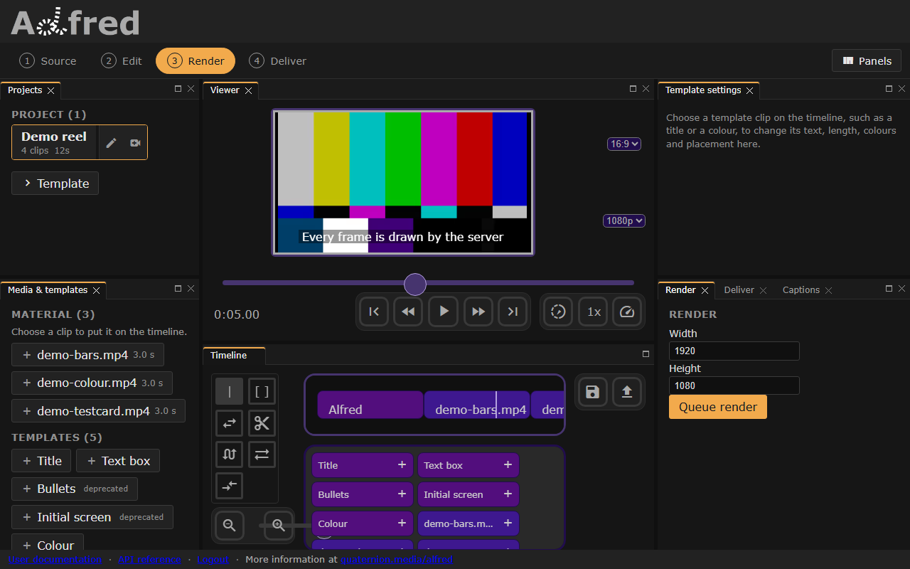

# Render



*The Render stage: the output's size, then Queue render.*

A `Render` is one request to make a video: an `Edl`, and how to render it. These are the fields a request may set. Every one but `edl` is optional.

``` python title="Render"
class Render:
    edl: Edl
    width: int = 1920          # 16 to 7680 pixels
    height: int = 1080         # 16 to 7680 pixels
    fps: float = 30.0          # 1 to 120 frames a second
    quality: str = 'standard'  # 'draft', 'standard' or 'high'
    name: str
    project: str
    project_id: str            # a project's id
    description: str
    duration: float
    captions: List[Caption]
    caption_style: CaptionStyle
```

## `edl`
: `#!python Edl`

    The timeline to render; see [Edl](edl.md). It is checked before anything is stored or queued, and a request is refused with a 422 naming the clip when a clip names media outside the library, or a template the server does not offer (`GET /templates` lists the ones it does).

## `width`, `height`
: `#!python int = 1920`, `#!python int = 1080`

    The frame, in pixels: 16 to 7680 each. Media is fitted inside it, keeping its proportions.

## `fps`
: `#!python float = 30.0`

    Frames a second, 1 to 120.

## `quality`
: `#!python str = 'standard'`

    How the video is encoded, as one of the server's presets: `draft` encodes fastest at the lowest quality, `high` slowest at the highest, and `standard` sits between them. The preset decides the encoder's settings, and a request carrying `bitrate` or `ffmpeg_params` is refused with a 422.

## `name`, `project`, `project_id`, `description`
: `#!python str`

    Labels. A download is named from `project` (or `name`), `description` and the size. `PUT /render/{id}` changes these four and nothing else.

## `duration`
: `#!python float`

    Kept with the render as sent; it does not change the video. The `Edl`'s own `duration`, or else the end of whichever clip ends last, decides how long the video runs.

## `captions`, `caption_style`
: `#!python List[Caption]`, `#!python CaptionStyle`

    Captions to draw over the timeline, and how. A request that carries captions has them drawn unless its style says `enabled: false`. See [Captions](../captions.md).

## What the server records
A render also carries what the server records about it, which no request can set: whatever a request sends for these is discarded.

- `username`: whose render it is
- `filename`: the output file, `<id>.mp4`
- `display_name`: what a download is called
- `status`, `progress` and `error`: where it has got to, which `GET /render/{id}/status` also says as a `state`
- `destination` and `link`: where it was last delivered

For a full working example, see [examples/render](../examples/render.md)
