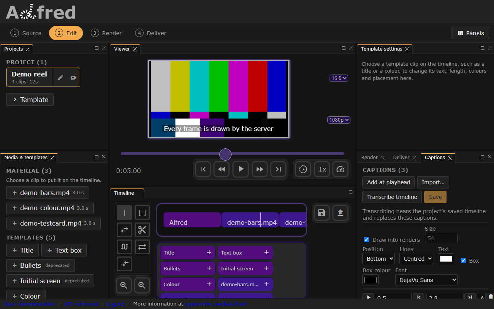
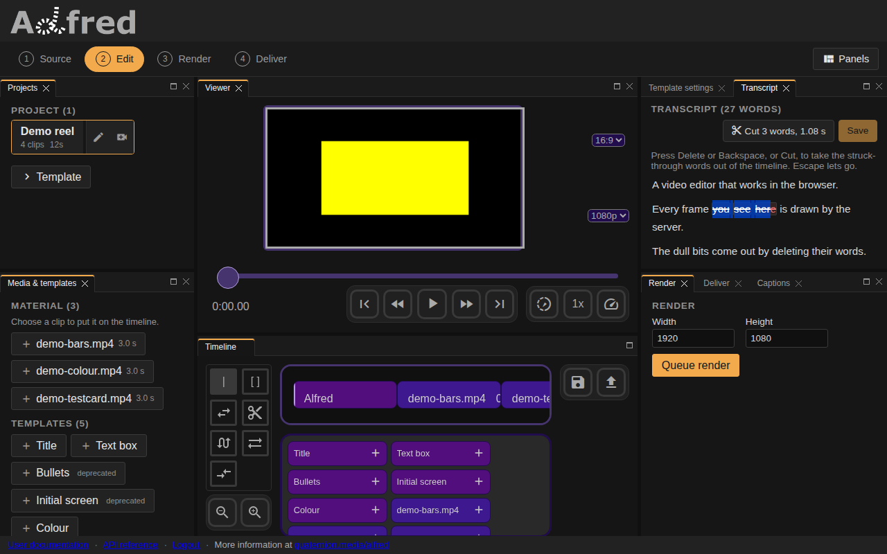
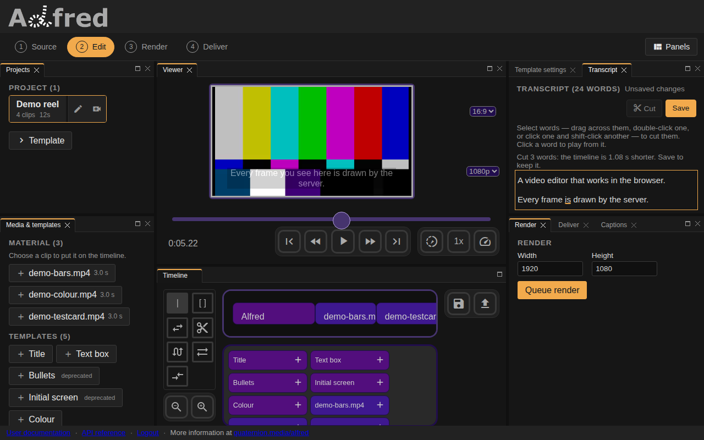

# Captions



*Captions imported from a SubRip file and drawn over the picture; the Captions tab sits beside Render and Deliver.*

A project's captions are lines of text and the stretch of the timeline each is
shown for, in timeline seconds: the seconds the editor's playhead counts and a
render's output runs in. They are typed in the editor, imported from a subtitle
file, or transcribed from the timeline's sound by an audio engine, and otto
draws them into renders.

alfred owns the captions, their jobs and their routes, and does no audio or
video work itself: otto mixes and writes the timeline's sound, and vox drives
an audio engine, joe by default, over HTTP ([The family dev loop](family.md)).

## In the editor

**Captions** is a tab in the workspace's right-hand column, beside Render and
Deliver, on a screen 1024 CSS pixels wide or more. Narrower, as on a phone,
it is the Edit stage's panel, above the viewer and the timeline; a switch at
the top of the stage swaps it for the Transcript panel, which edits the
timeline by what is said in it: [Editing by text](#editing-by-text).

- **Add at playhead** adds a two-second caption at the playhead. Each row has a
  start and an end in seconds, typed or set from the playhead; the text; and
  buttons to play from the caption's start and to delete it. The list stays in
  start order and marks a caption that cannot be shown (no text, an end before
  its start) and why. Nothing saves while one is marked.
- **Import…** has the server read a SubRip (`.srt`), WebVTT (`.vtt`) or JSON
  file, and shows what it found: how many captions, how many cues were left out
  for having no text or no length, and the first few. Use them, add them to the
  captions there, or cancel. Accepting saves.
- **Transcribe timeline** has the server's audio engine hear the project's
  *saved* timeline, and replaces the captions with what it heard, asking first
  if there are captions to replace. It is unavailable, and says why, when the
  server has no audio engine, the engine is not answering, or no renderer is
  running to mix the sound; until the server says which, it shows "Checking the
  audio engine…". The panel follows the job until it is done (how many segments
  of speech were heard) or has failed (why).
- **Style**: whether captions are drawn into renders; their size, position,
  line alignment, text colour, box and box colour; and the font. **Draw into
  renders** is off until you tick it, since imported or transcribed captions
  are often still being corrected.
- **Save** keeps the captions and the style on the project.

The caption under the playhead shows over the viewer in its style, faint while
the style does not draw into renders: a likeness the page draws, where the
server draws the render. Once **Draw into renders** is ticked, every render of
the timeline carries the captions and their style exactly as they stand in the
editor, saved or not, as it carries the timeline.

## Through the API

| Route | |
|---|---|
| `GET /project/{id}/captions` | `{captions, style, job}` |
| `PUT /project/{id}/captions` | `{captions, style?, words?}`: stores those and nothing else; answers as `GET` does |
| `GET /project/{id}/captions/words` | `{words}`: the transcript, word by word |
| `POST /project/{id}/captions/import` | `{format: "srt"\|"vtt"\|"json", text}` → `{captions, skipped}`; stores nothing |
| `POST /project/{id}/captions/transcribe` | `202 {job}`; `503` with the reason when there is no engine (`audio_engine_missing`) or the job could not be queued (`transcription_not_queued`); `409` while one runs; `422` when the saved timeline has nothing to hear |
| `GET /media/{name}/audio` | the engine's analysis of a library file |
| `GET /health` | gains `audio_engine: {configured, ok, detail}` |

Each route is scoped to the caller, like every project route: a project that
is not yours answers 404. `GET /project/{id}` carries `captions` and
`caption_style` too, and not the words, which run to thousands in a long
talk. A refusal carries a `code` beside its `detail`;
[Refusals](api/errors.md) lists them.

A caption is `{start, end, text}`: `start` at or after 0, `end` after it, and
text that says something, at most 500 characters. A project carries at most
1000, kept in start order.

A word is `{start, end, text, segment}`, in timeline seconds: `end` no earlier
than `start` (an engine times some words as taking no time at all), `text` one
word of at most 100 characters, and `segment` which stretch of speech it was
heard in, counted from 0. A project keeps at most 50,000, in the order heard.
A transcription replaces them; `PUT /project/{id}/captions` replaces them when
it is sent `words`, and keeps them when it is not, so that the editor writes
the captions and the words of a cut together ([Editing by
text](#editing-by-text)). A request whose words break these rules is refused
422, by FastAPI, with no `code`.

The style is `{enabled, fontsize, color, bg, position, align, font}`, the
textBox template's own fields, every one optional:

| Field | Default | |
|---|---|---|
| `enabled` | false, on a project | whether renders draw the captions |
| `fontsize` | 54 | pixels in a 1080-line frame, scaled with the render: 36 at 720 |
| `color` | `#ffffff` | `#rgb` or `#rrggbb` |
| `bg` | `#000000` | the box behind the text, drawn at 40% opacity; `""` for none |
| `position` | `bottom` | `bottom`, `top`, `center`, or `[across, down]` -- `left`/`center`/`right`, `top`/`center`/`bottom` |
| `align` | `center` | how lines line up: `center`, `west`, `east` (`left`, `right` are taken too) |
| `font` | `DejaVu-Sans` | a font name as ImageMagick lists it |

**`enabled` on a project and on a render.** Once a project has captions, its
style always states `enabled`: as sent, else as it was, else false. So a client
reading the project knows whether its renders draw them. A render request
differs: `POST /render` takes optional `captions` and `caption_style`, and
draws the captions it carries unless its style says `enabled: false`.

The job is `{state, error, engine, segments, updated_at}`: `state` is
`queued`, `transcribing`, `done` or `failed`; `error` says in a line why it
failed; `engine` is the address it was sent to, without credentials;
`segments` is how many stretches of speech the engine heard. A job not heard
from for the engine's timeout plus a quarter of an hour counts as abandoned (a
worker that died), and another may start.

## Importing subtitles

The readers forgive what is unambiguous, and name the line they cannot read
when it is not:

- a byte-order mark; CRLF, LF or CR line ends;
- `,` or `.` before the milliseconds, one to nine digits of them, hours past
  99 or no hours at all (`01:02.500`);
- SubRip index numbers or none, and coordinates after the timing;
- WebVTT's header, cue identifiers, cue settings (`align:start`), and its
  `NOTE`, `STYLE` and `REGION` blocks;
- markup inside a cue (`<i>`, `<font>`, `<c.yellow>`, `<v Speaker>`, inline
  timestamps, `{\an8}`), which a render does not draw, and HTML entities;
- cues with no text or no length, which are left out and counted.

JSON is a list of `{start, end, text}`, or an object holding one under
`captions` (as alfred answers), `segments` (as a speech engine answers) or
`cues`. Times are seconds, or timestamps such as `"00:00:01,500"`.

## How captions render

Each caption becomes one `textBox` template clip, appended after the
timeline's own clips so it draws over them, with an explicit `start`, a
`duration` of `end - start`, and no fades. A caption past the end of the
timeline is left out, and one running over it is cut there: captions never
lengthen a render.

The clips are made from the style when the render is queued, for the render's
own frame:

- the font size scales with the frame's height;
- the caption sits inside a safe area inset 5% from the top and bottom;
- the box behind it is sized to the text, estimated from DejaVu Sans's own
  glyph widths;
- the text wraps at 90% of the frame's width.

A render keeps its captions beside its timeline, not written into it, so a
rerender makes the clips again and draws them as the first render did.

## Transcribing a timeline

`POST /project/{id}/captions/transcribe` queues a job on the render queue. The
worker that renders is the one that transcribes, so `GET /health`'s renderer
count says whether anything will pick it up.

1. otto builds the project's saved timeline from its video and audio clips, as
   long as the whole timeline so times do not move (silence stands where the
   other clips were), and writes the mix as a 16 kHz mono WAV in a directory
   private to the job, removed afterwards.
2. The audio engine hears it, through vox, with word timings.
3. What it heard becomes captions a person can read in the time they are
   shown. A stretch of speech is cut at word boundaries into captions of at
   most two lines (84 characters) and seven seconds, ending at a sentence's end
   where there is one. Times are clamped to the timeline, and empty text is
   dropped.
4. The captions replace the project's own, the words they were made of
   replace the project's words, and the job says `done`. A project that had no
   style gets one that does not draw them into renders until someone ticks
   the box. The words are those of the stretches that made captions, clamped
   to the timeline as they are; a stretch the engine gave no word timings for
   keeps none.

A failure (no sound in the timeline, a media name the library does not hold, an
engine that is missing, refuses or does not answer) leaves the captions and the
words as they were, and the job `failed` with the reason in a line.

## Editing by text



*"you see here" selected: the words a cut would take are struck through before they go.*

Once the timeline has been transcribed, the **Transcript** panel shows what
was said as running text, a paragraph to each stretch of speech the engine
heard. Delete words from it, and the stretch they were said in is cut out of
the video. On a screen 1024 CSS pixels wide or more it is a tab beside
Template settings, above the Captions tab, and in the Panels menu. Narrower,
as on a phone, the Edit stage shows one panel at a time, Captions until the
switch at its top chooses **Transcript**: stacked, the two left each other
too little of a phone's height to use.

- **Select** words as any text is selected: drag across them, double-click
  one, or click one and shift-click another; on a phone, press and hold. The
  words a cut would take are struck through, and **Cut** says how many and how
  long they last.
- **Delete**, **Backspace** or **Cut** cuts them. The stretch goes from every
  track of the timeline at once, video and sound alike: a clip is split at its
  edges and loses what is inside it, and everything after it moves up by its
  length. What is left of a clip plays on from where the cut ended, a
  template's animation included, and meets its neighbour with a hard edit: a
  part that begins or ends at a cut has no fade there.
- The captions and the words move with it. A caption the stretch overlaps is
  trimmed by it, and one with nothing left is dropped; those after it move up.
  A caption's text is not rewritten: one that said a cut word still says it,
  for less time. Correct it in the Captions panel, or transcribe the saved
  timeline again.
- **Click** a word to put the playhead where it starts. The word under the
  playhead is underlined as the timeline plays. **Escape** lets go of a
  selection.
- **Save** keeps the timeline, then the captions and the words, through the
  routes the toolbar and the Captions panel save with; until then, the cut is
  the page's, as any edit of the timeline is. The toolbar's save keeps the
  timeline alone.



*After the cut: the colour bars lost their end and the test card its start, and the captions after the cut moved up.*

A project with no transcript says so in a line, beside **Transcribe timeline**
([Transcribing a timeline](#transcribing-a-timeline)), which asks first if
there are captions it would replace.

**The span cut.** A cut takes the timeline from the first selected word's
start to the last selected word's end, as the engine timed them, and nothing
either side: no constant in alfred pads a word, so neither does the cut.
Speech engines' word times can overlap and leave gaps. A gap between selected
words goes with them; a word the span holds the whole of goes too, selected
or not, and is struck through first; a word it only overlaps stays, trimmed. A
word that takes no time goes when it sits in the span, its edges included.
The span is clamped to the timeline, so a span past its end cuts nothing, and
a selection that takes no time is no cut at all. What is left of a clip is
kept however short, since dropping a sliver would cut more than was selected;
a clip the span does not touch keeps its window as it was. Several spans can
be cut as one edit, in any order (`cutRanges` takes a list): they are sorted,
and those that overlap or meet are merged.

**No undo.** The editor has none, so a cut has none either. Until it is
saved, reloading the page and discarding the timeline it offers back returns
the project as it was saved.

**The words belong to the timeline that was heard.** They are in timeline
seconds of the saved timeline as it was transcribed, and a cut moves them
with the timeline; other edits -- a trim, a move, a clip added -- do not, so
the text no longer lines up with the picture after them. Transcribe the saved
timeline again to bring it back in step. The editor lays its clips end to end,
so the words of a timeline saved from elsewhere with overlapping clips line up
only once the editor has saved it.

The cut itself is one function, `cutRanges` in `website/src/ClipWindow.js`:
arithmetic on the timeline, which is the project's own state. It does no
media work; otto renders the result as it renders any timeline.

## The audio engine

alfred reaches the engine through vox's `EngineContract`: the paths, parameter
names and response keys an engine must answer with, as a value whose defaults
are joe's spelling. `alfred/core/utils/audio_engine.py` builds it from the
settings and is the only module in alfred that imports vox; nothing in alfred
spells an engine's path or key. vox's media client (`vox.media.MediaEngine`)
uploads the sound and asks for a transcript or an analysis. By default that is
joe's media API: `POST /api/media`, then `/api/media/{id}/transcribe` or
`/analyze`.

The settings are `ALFRED_AUDIO_ENGINE_URL`, `ALFRED_AUDIO_ENGINE_TIMEOUT` and
`ALFRED_AUDIO_ENGINE_CONTRACT_<FIELD>`; [Configuration](configuration.md) has
their defaults. Each goes to the api, which asks the engine for `/health` and
for analyses, and to the renderer, which transcribes. Since transcribing runs on
the render worker, nothing else waits on it. joe takes about 18 s for its first
transcription after it starts, then roughly as long as the speech, on a CPU.

The vendored vox carries the media client, `vox.media`. A build whose vox lacks
it says so in `GET /health`'s `audio_engine.detail`, answers a transcription
503 with the same reason, and sends nothing to the engine.

### Pointing alfred at joe

joe's own CLI binds 8000, which is alfred's port. In joe's checkout, run its
API on another one:

```sh
uv run uvicorn api:app --port 8010
```

and start alfred with the address its containers reach the host by:

```sh
ALFRED_AUDIO_ENGINE_URL=http://host.docker.internal:8010 ./al dev
```

On a Linux host, joe has to listen on an address the containers can reach: see
[Docker hosts and joe](configuration.md#docker-hosts-and-joe). Then
`GET /health` should answer `audio_engine: {configured: true, ok: true}`. It
needs a session: send a token, or start the stack with
`ALFRED_DEV_SKIP_AUTH=1`. `GET /healthz` needs none, and says only that the api
is up. As with any port, check what is answering before trusting it.

### Analysing library media

`GET /media/{name}/audio` hands a library file to the engine and answers its
analysis. `name` is as `GET /media` lists it, `videos/<file>`, or the bare file
name. The analysis holds `duration`, `tempo` (beats a minute), `beats` and
`onsets` (seconds), `loudness` (`rms_db`, `peak_db`, `lufs`), `silences`
(`[{start, end}]`) and `peaks` (`{rate, values}`, 0 to 1). `features` asks for
some of `tempo`, `beats`, `onsets`, `loudness`, `silences` and `peaks`; all by
default. The answer is kept until the file changes.

Its refusals ([Refusals](api/errors.md)):

- 404 for a file the library does not hold (`not_found`);
- 422 for an image (`media_silent`), a file the engine will not read
  (`audio_engine_refused`) or a feature it does not know (`unknown_feature`);
- 502 when the engine fails (`audio_engine_failed`);
- 503 when there is none (`audio_engine_missing`).

## Testing

No test needs joe, a speech model or a download.

- `tests/unit/test_audio_engine.py` drives the adapter against a fake of vox's
  media client, with an alien contract that shares no path, parameter or key
  with the default, and greps alfred's own source for any of joe's spellings.
- `tests/stubs/audio_engine.py` is a deterministic engine speaking joe's media
  API. It hears a segment of "speech" wherever the sound it is sent is louder
  than a whisper, timed where the sound is. The pipeline tier mixes real
  timelines through it in-process. `test_e2e.yml` runs it as the browser
  suite's engine, and has it write `videos/e2e-speech.wav`, two bursts of tone,
  into the library for a timeline to transcribe.
- `tests/pipeline/test_caption_pipeline.py` encodes captions and reads the
  frames back: text and its box where the style puts them, while they are shown
  and not otherwise.
- `website/e2e/cut-ranges.spec.js` holds `cutRanges` to its edges, in Node,
  with no browser or server: a range across a clip boundary, several tracks and
  sound-only clips, ranges apart, overlapping and out of order, at the
  timeline's start and end and past it, and selections with no length.
  `website/e2e/transcript.spec.js` edits by text in the browser, on the
  workspace and on a phone: its `@slow` test transcribes a timeline through
  the stub engine and cuts two of the words it heard; the others put words on
  the project through the API.
