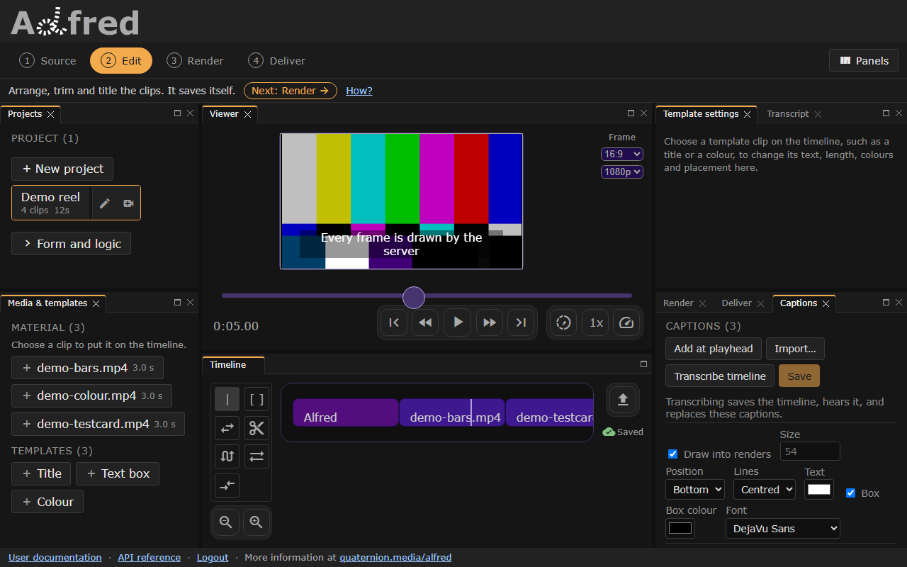

# Captions



*Captions imported from a SubRip file and drawn over the picture; the Captions tab sits beside Render and Deliver.*

A project's captions are lines of text and the stretch of the timeline each is
shown for, in timeline seconds: the seconds the editor's playhead counts and a
render's output runs in. They are typed in the editor, imported from a subtitle
file, or transcribed from the timeline's sound by an audio engine, and otto
draws them into renders.

alfred owns the captions, their jobs and their routes, and does no audio or
video work itself: otto mixes and writes the timeline's sound, and vox drives
an audio engine, joe by default, over HTTP ([The family dev loop](family.md)).

## In the editor

**Captions** is a tab in the workspace's right-hand column, beside Render and
Deliver, on a screen 1024 CSS pixels wide or more. Narrower, as on a phone,
it is the Edit stage's panel, above the viewer and the timeline; a switch at
the top of the stage swaps it for the Transcript panel, which edits the
timeline by what is said in it: [Editing by text](editing-by-text.md).

- **Add at playhead** adds a two-second caption at the playhead. Each row has a
  start and an end in seconds, typed or set from the playhead; the text; and
  buttons to play from the caption's start and to delete it. The list stays in
  start order and marks a caption that cannot be shown (no text, an end before
  its start) and why. Nothing saves while one is marked.
- **Import…** has the server read a SubRip (`.srt`), WebVTT (`.vtt`) or JSON
  file, and shows what it found: how many captions, how many cues were left out
  for having no text or no length, and the first few. Use them, add them to the
  captions there, or cancel. Accepting saves.
- **Transcribe timeline** saves the timeline, has the server's audio engine
  hear it, and replaces the captions with what it heard, asking first
  if there are captions to replace. It is unavailable, and says why, when the
  server has no audio engine, the engine is not answering, or no renderer is
  running to mix the sound; until the server says which, it shows "Checking the
  audio engine…". The panel follows the job until it is done (how many segments
  of speech were heard) or has failed (why).
- **Style**: whether captions are drawn into renders; their size, position,
  line alignment, text colour, box and box colour; and the font. **Draw into
  renders** is off until you tick it, since imported or transcribed captions
  are often still being corrected.
- **Save** keeps the captions and the style on the project, and the timeline
  and the words with them once an edit has moved them ([Saving](editing-by-text.md#saving)).

The caption under the playhead shows over the viewer in its style, faint while
the style does not draw into renders: a likeness the page draws, where the
server draws the render. Once **Draw into renders** is ticked, every render of
the timeline carries the captions and their style exactly as they stand in the
editor, saved or not, as it carries the timeline.

## Through the API

| Route | |
|---|---|
| `GET /project/{id}/captions` | `{captions, style, job}` |
| `PUT /project/{id}/captions` | `{captions, style?, words?, timeline?}`: stores those and nothing else, in one write; answers as `GET` does |
| `GET /project/{id}/captions/words` | `{words}`: the transcript, word by word |
| `POST /project/{id}/captions/import` | `{format: "srt"\|"vtt"\|"json", text}` → `{captions, skipped}`; stores nothing |
| `POST /project/{id}/captions/transcribe` | `202 {job}`; `503` with the reason when there is no engine (`audio_engine_missing`) or the job could not be queued (`transcription_not_queued`); `409` while one runs; `422` when the saved timeline has nothing to hear |
| `GET /media/{name}/audio` | the engine's analysis of a library file |
| `GET /health` | gains `audio_engine: {configured, ok, detail}` |

Each route is scoped to the caller, like every project route: a project that
is not yours answers 404. `GET /project/{id}` carries `captions` and
`caption_style` too, and not the words, which run to thousands in a long
talk. A refusal carries a `code` beside its `detail`;
[Refusals](api/errors.md) lists them.

A caption is `{start, end, text}`: `start` at or after 0, `end` after it, and
text that says something, at most 500 characters. A project carries at most
1000, kept in start order.

A word is `{start, end, text, segment}`, in timeline seconds: `end` no earlier
than `start` (an engine times some words as taking no time at all), `text` one
word of at most 100 characters, and `segment` which stretch of speech it was
heard in, counted from 0. A project keeps at most 50,000, in the order sent:
the order heard, until an edit moves some ahead of others. A transcription
replaces them; `PUT /project/{id}/captions` replaces them when it is sent
`words`, and keeps them when it is not. A request whose words break these
rules is refused 422, by FastAPI, with no `code`.

`timeline` on the same request is the project's timeline, `{clips,
duration}`, stored as `PUT /project/{id}/timeline` stores it. The editor
sends the timeline, the captions and the words together whenever an edit has
moved them, so the three are saved in one write and are never saved apart
([Saving](editing-by-text.md#saving)). A timeline otto cannot read is refused 422, and nothing
is written.

The style is `{enabled, fontsize, color, bg, position, align, font}`, the
textBox template's own fields, every one optional:

| Field | Default | |
|---|---|---|
| `enabled` | false, on a project | whether renders draw the captions |
| `fontsize` | 54 | pixels in a 1080-line frame, scaled with the render: 36 at 720 |
| `color` | `#ffffff` | `#rgb` or `#rrggbb` |
| `bg` | `#000000` | the box behind the text, drawn at 40% opacity; `""` for none |
| `position` | `bottom` | `bottom`, `top`, `center`, or `[across, down]` -- `left`/`center`/`right`, `top`/`center`/`bottom` |
| `align` | `center` | how lines line up: `center`, `west`, `east` (`left`, `right` are taken too) |
| `font` | `DejaVu-Sans` | a font name as ImageMagick lists it |

**`enabled` on a project and on a render.** Once a project has captions, its
style always states `enabled`: as sent, else as it was, else false. So a client
reading the project knows whether its renders draw them. A render request
differs: `POST /render` takes optional `captions` and `caption_style`, and
draws the captions it carries unless its style says `enabled: false`.

The job is `{state, error, engine, segments, updated_at}`: `state` is
`queued`, `transcribing`, `done` or `failed`; `error` says in a line why it
failed; `engine` is the address it was sent to, without credentials;
`segments` is how many stretches of speech the engine heard. A job not heard
from for the engine's timeout plus a quarter of an hour counts as abandoned (a
worker that died), and another may start.

## Importing subtitles

The readers forgive what is unambiguous, and name the line they cannot read
when it is not:

- a byte-order mark; CRLF, LF or CR line ends;
- `,` or `.` before the milliseconds, one to nine digits of them, hours past
  99 or no hours at all (`01:02.500`);
- SubRip index numbers or none, and coordinates after the timing;
- WebVTT's header, cue identifiers, cue settings (`align:start`), and its
  `NOTE`, `STYLE` and `REGION` blocks;
- markup inside a cue (`<i>`, `<font>`, `<c.yellow>`, `<v Speaker>`, inline
  timestamps, `{\an8}`), which a render does not draw, and HTML entities;
- cues with no text or no length, which are left out and counted.

JSON is a list of `{start, end, text}`, or an object holding one under
`captions` (as alfred answers), `segments` (as a speech engine answers) or
`cues`. Times are seconds, or timestamps such as `"00:00:01,500"`.

## How captions render

Each caption becomes one `textBox` template clip, appended after the
timeline's own clips so it draws over them, with an explicit `start`, a
`duration` of `end - start`, and no fades. A caption past the end of the
timeline is left out, and one running over it is cut there: captions never
lengthen a render.

The clips are made from the style when the render is queued, for the render's
own frame:

- the font size scales with the frame's height;
- the caption sits inside a safe area inset 5% from the top and bottom;
- the box behind it is sized to the text, estimated from DejaVu Sans's own
  glyph widths;
- the text wraps at 90% of the frame's width.

A render keeps its captions beside its timeline, not written into it, so a
rerender makes the clips again and draws them as the first render did.

## Transcribing a timeline

`POST /project/{id}/captions/transcribe` queues a job on the render queue. The
worker that renders is the one that transcribes, so `GET /health`'s renderer
count says whether anything will pick it up.

1. otto builds the project's saved timeline from its video and audio clips, as
   long as the whole timeline so times do not move (silence stands where the
   other clips were), and writes the mix as a 16 kHz mono WAV in a directory
   private to the job, removed afterwards ([otto's `renderSound`](https://github.com/quaternionmedia/otto/blob/51a1b0eb1d53d99f3ae55083406901ed1255ec40/docs/rendering.md#a-timelines-sound-alone)).
2. The audio engine hears it, through vox, with word timings.
3. What it heard becomes captions a person can read in the time they are
   shown. A stretch of speech is cut at word boundaries into captions of at
   most two lines (84 characters) and seven seconds, ending at a sentence's end
   where there is one. Times are clamped to the timeline, and empty text is
   dropped.
4. The captions replace the project's own, the words they were made of
   replace the project's words, and the job says `done`. A project that had no
   style gets one that does not draw them into renders until someone ticks
   the box. The words are those of the stretches that made captions, clamped
   to the timeline as they are; a stretch the engine gave no word timings for
   keeps none.

A failure (no sound in the timeline, a media name the library does not hold, an
engine that is missing, refuses or does not answer) leaves the captions and the
words as they were, and the job `failed` with the reason in a line.

## Editing by text

Once the timeline is transcribed, deleting words from the **Transcript** cuts
the stretch they were said in out of the video, and the captions and the words
move with every edit: [Editing by text](editing-by-text.md) has the rules, and
how the timeline, the captions and the words are saved together.

## The audio engine

alfred asks the engine two things: a transcript of the timeline's sound, with
each word timed, and an analysis of a library file. It asks through vox, whose
`EngineContract` names the paths, parameters and keys an engine answers with,
joe's by default, and whose `MediaEngine` uploads the sound and reads the
answer. vox's README owns both: [the contract](https://github.com/quaternionmedia/vox/blob/e630cb007b63e5e67f95cf62a72528bdef39a4ac/README.md#pointing-vox-at-something-else)
and [the media client](https://github.com/quaternionmedia/vox/blob/e630cb007b63e5e67f95cf62a72528bdef39a4ac/README.md#media-a-transcript-with-times-and-what-the-sound-measures).
In alfred, only `alfred/core/utils/audio_engine.py` imports vox, and nothing
else spells an engine's path or key.

The settings are `ALFRED_AUDIO_ENGINE_URL`, `ALFRED_AUDIO_ENGINE_TIMEOUT` and
`ALFRED_AUDIO_ENGINE_CONTRACT_<FIELD>` ([Configuration](configuration.md#the-audio-engine)).
The api uses them for `/health` and analyses, the renderer to transcribe, so
a transcription waits on nothing else. A build whose vox lacks the media client
says so in `GET /health`'s `audio_engine.detail`, answers a transcription 503
with the same reason, and sends nothing to the engine.

### Pointing alfred at joe

`./al family up` does all of it ([The family dev loop](family.md)). By hand,
run joe's API on 1059, joe's place in qm's port allocation, from joe's
checkout:

```sh
uv run uvicorn api:app --port 1059
```

and start alfred with the address its containers reach the host by:

```sh
ALFRED_AUDIO_ENGINE_URL=http://host.docker.internal:1059 ./al dev
```

On a Linux host, joe has to listen where the containers can reach it
([Docker hosts and joe](configuration.md#docker-hosts-and-joe)). Then
`GET /health`, with a session, answers `audio_engine: {configured: true, ok:
true}`. On a CPU, joe's first transcription after it starts takes about 18
seconds, loading its speech model; after that, about as long as the speech.
[joe's media API](https://github.com/quaternionmedia/joe/blob/main/docs/media.md) is joe's side of it.

### Analysing library media

`GET /media/{name}/audio` hands a library file to the engine and answers its
analysis, kept until the file changes. `name` is as `GET /media` lists it,
`videos/<file>`, or the bare file name. `features` asks for some of `tempo`,
`beats`, `onsets`, `loudness`, `silences` and `peaks`, all by default; each is
a field of vox's `Analysis`, which says what it holds. Its refusals
([Refusals](api/errors.md)):

- 404 for a file the library does not hold (`not_found`);
- 422 for an image (`media_silent`), a file the engine will not read
  (`audio_engine_refused`) or a feature it does not know (`unknown_feature`);
- 502 when the engine fails (`audio_engine_failed`);
- 503 when there is none (`audio_engine_missing`).

## Testing

No test needs joe, a speech model or a download. `tests/stubs/audio_engine.py`
is a deterministic engine speaking joe's media API: it hears "speech" wherever
the sound is louder than a whisper, and the pipeline tier and the browser suite
transcribe through it. `tests/unit/test_audio_engine.py` drives the adapter
against a contract that shares no spelling with joe's;
`tests/pipeline/test_caption_pipeline.py` reads the drawn captions back from
the frames; `cut-ranges.spec.js` and `follow-clips.spec.js` hold `cutRanges`
and `followClips` to their edges in Node; and `transcript.spec.js` edits by
text in the browser, on the workspace and on a phone.
