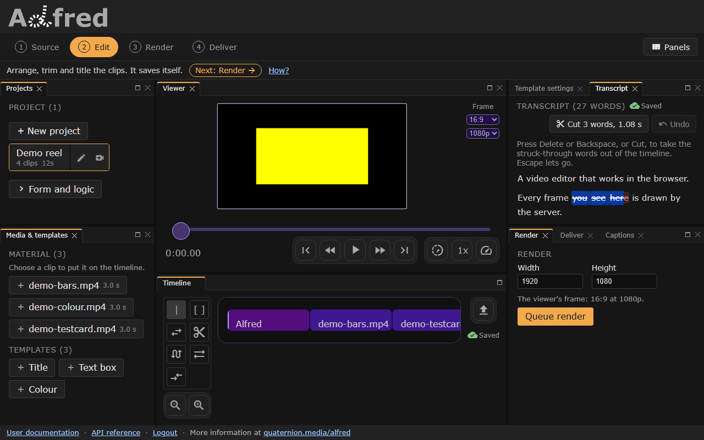
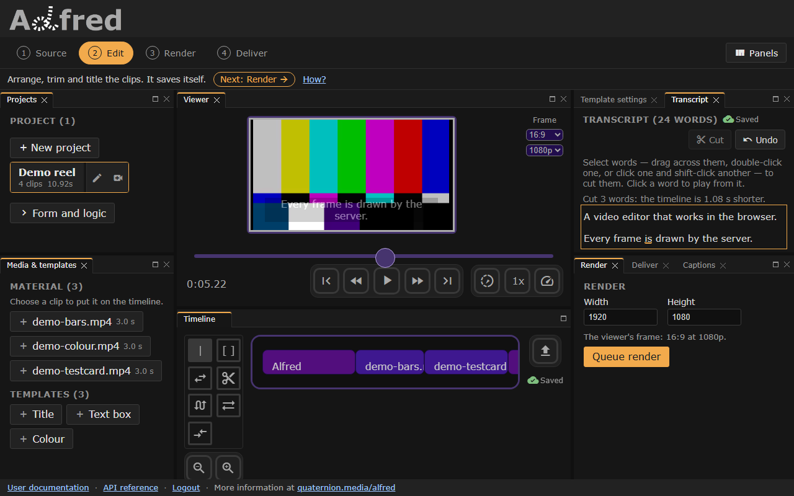

# Editing by text

*"you see here" selected: the words a cut would take are struck through before they go.*

Once the timeline has been transcribed, the **Transcript** panel shows what
was said as running text, a paragraph to each stretch of speech the engine
heard. Delete words from it, and the stretch they were said in is cut out of
the video. On a screen 1024 CSS pixels wide or more it is a tab beside
Template settings, above the Captions tab, and in the Panels menu. Narrower,
as on a phone, the Edit stage shows one panel at a time, Captions until the
switch at its top chooses **Transcript**: stacked, the two left each other
too little of a phone's height to use.

- **Select** words as any text is selected: drag across them, double-click
  one, or click one and shift-click another; on a phone, press and hold. The
  words a cut would take are struck through, and **Cut** says how many and how
  long they last.
- **Delete**, **Backspace** or **Cut** cuts them. The stretch goes from every
  track of the timeline at once, video and sound alike: a clip is split at its
  edges and loses what is inside it, and everything after it moves up by its
  length. What is left of a clip plays on from where the cut ended, a
  template's animation included, and meets its neighbour with a hard edit: a
  part that begins or ends at a cut has no fade there.
- The captions and the words move with it. A caption the stretch overlaps is
  trimmed by it, and one with nothing left is dropped; those after it move up.
  A caption that loses words says the words it has left: [A caption's
  words](#a-captions-words).
- **Ctrl+Z** (**Cmd+Z** on a Mac) or **Undo** takes back the last cut:
  [Undo](#undo).
- **Click** a word to put the playhead where it starts. The word under the
  playhead is underlined as the timeline plays. **Escape** lets go of a
  selection.
- The cut saves itself a moment later: the timeline, the captions and the
  words, in one request ([Saving](#saving)).

*After the cut: the colour bars lost their end and the test card its start, and the captions after the cut moved up.*

A project with no transcript says so in a line, beside **Transcribe timeline**
([Transcribing a timeline](captions.md#transcribing-a-timeline)), which asks first if
there are captions it would replace.

**The span cut.** A cut takes the timeline from the first selected word's
start to the last selected word's end, as the engine timed them, and nothing
either side: no constant in alfred pads a word, so neither does the cut.
Speech engines' word times can overlap and leave gaps. A gap between selected
words goes with them; a word the span holds the whole of goes too, selected
or not, and is struck through first; a word it only overlaps stays, trimmed. A
word that takes no time goes when it sits in the span, its edges included.
The span is clamped to the timeline, so a span past its end cuts nothing, and
a selection that takes no time is no cut at all. What is left of a clip is
kept however short, since dropping a sliver would cut more than was selected;
a clip the span does not touch keeps its window as it was. Several spans can
be cut as one edit, in any order (`cutRanges` takes a list): they are sorted,
and those that overlap or meet are merged.

The cut itself is one function, `cutRanges` in `website/src/ClipWindow.js`:
arithmetic on the timeline, which is the project's own state. It does no
media work; otto renders the result as it renders any timeline.

## Undo

**Ctrl+Z** (**Cmd+Z** on a Mac) in the Transcript panel, or its **Undo**
button, takes back the last cut: the timeline, the captions and the words
come back as they were before it, as one edit, and the words it took come
back selected, so **Delete** would cut them again. Up to ten cuts are undone
one at a time, the last first.

Undo covers the cuts made in the Transcript panel, and nothing else. It
takes one back only while nothing else has changed the timeline, the
captions or the words since: an edit with the timeline tools, a caption
typed, imported or transcribed, a restored draft, or opening another
project keeps the cuts made before it, and Undo says so. Saving is not such a
change: a cut that has saved itself can still be undone, and the undo saves
as the cut did. A reload forgets what could be undone, and the editor has no
other undo.

## Words follow the picture

The words and the captions are in timeline seconds, so an edit that moves the
picture moves them with it. The editor lays its clips end to end on one
track, and no edit leaves a gap: what comes after an edited clip closes up or
moves on by exactly what the edit changed. How each tool changes the clips
decides what happens to what was said in them ([Editing tools](tools.md)):

| Edit | The clips | The words and the captions |
|---|---|---|
| Trim | the clip's end moves, and everything after it by as much | those in the end it lost go; those after move with their clips |
| Move | the clip goes elsewhere in the order, and the rest close up | its words go with it; the rest move as their clips do |
| A clip dragged off the timeline | it goes, and what follows moves up | its words go |
| A clip added | it goes in where it is put, and what follows moves on | those after it move on; nothing is said over the new clip |
| Slip | the clip shows another part of its file, in the same place | its words move with the picture, and those now outside its window go |
| Slide | the clip moves between its neighbours, which give and take the time | its words move with it; its neighbours' follow their windows |
| Dual roller | the cut between two clips moves, and nothing else | what either clip lost at the cut goes; nothing moves |
| Cut, or S | the clip becomes two that meet | nothing moves |
| A template's **Duration**, typed | as a trim, once the field is left | as a trim |

Each word and caption follows its material: the second of its clip's file,
or of a template's animation, that it lies over. Where the edit kept that
second, it goes wherever the second now plays; where the edit lost it, it
goes. One that spans clips stays one stretch across the parts that still
follow each other, in the same clip or neighbouring ones, with whatever new
material lies between them, such as what a trim or a roll revealed. When an
edit parts them, as a move can, it keeps its longest part. A caption that
loses words says the words it has left ([A caption's words](#a-captions-words)).
A caption past the end of the timeline, over nothing, stays where it is. A
still picture has no place in a file, so what it loses is taken from its
end. The words are kept in the order they play, so after a move the
transcript reads as the picture does.

This is one function, `followClips` in `website/src/ClipWindow.js`, given the
clips before an edit and after it. A tool marks the timeline when its edit
begins and hands the mark over when the edit is done: a drag the browser
takes back moves nothing, and a typed duration is followed once, when its
field is left. An edit made while the project's captions or words are still
loading is followed once they arrive. The editor loads both whenever it opens
a project, whether or not their panels are showing.

The words are those of the saved timeline as it was transcribed, followed
through every edit since. A transcription hears the *saved* timeline, and
**Transcribe timeline** saves it first. The editor lays its clips end to end, so the words
of a timeline saved from elsewhere with overlapping clips line up only once
the editor has saved it.

## Saving

The timeline saves itself a second after it stops changing
(`website/src/Autosave.js`); the indicator beside the timeline, and in the
Transcript panel, says **Saving…**, then **Saved**. An edit that moves the
captions and the words saves all three together, in one request, `PUT
/project/{id}/captions` with `timeline` ([Through the API](captions.md#through-the-api)),
so the project never holds a timeline and words from different edits. The
Captions panel's **Save** writes them the same way once an edit has moved
them. Until then, a save writes the timeline alone, `PUT
/project/{id}/timeline`, and the Captions panel's **Save** the captions and
their style.

A caption still marked in the Captions panel holds the timeline's save back,
and the indicator says **Not saved**, with why: the captions cannot be
written as they are, and the timeline is not written without them. A save
that fails says so once, then tries again after 5, 15 and 30 seconds and on
the next change; **Retry** tries at once. Meanwhile the edit is kept in the
tab ([Drafts](#drafts)). Opening another project saves the one being left
first, and **Transcribe timeline** saves before it asks for anything.

## Drafts

A timeline not yet saved, after a save that failed or a page left in the
second before one, is kept in the tab and offered back when the project is
opened again (`website/src/Draft.js`). The captions and the words an edit
moved are kept in the same entry, and **Restore them** brings the three back
together, and they save themselves. Until the offer is answered, the
indicator says **Not saved**, and nothing is saved over it. It waits until the project's saved
captions and words have loaded, so they cannot arrive after it and replace
what it restored. **Discard** keeps what is saved, all three. A draft kept
before this release holds the timeline alone and restores as it did.

## A caption's words

A caption's words are the transcript's words whose middle lies inside it:
the words it was made of, for a caption a transcription made, and the words
said while it is shown, for one typed or imported. When an edit takes some of
them, the caption's text is rewritten as the words it has left, in the order
they are said, joined by spaces; a correction typed into it goes with the rest
of its old text. When an edit takes all of them, the caption goes, even if
some of its time is left: it would show only what was cut. A caption that
holds no words, or loses none of them, keeps its text as it is.

