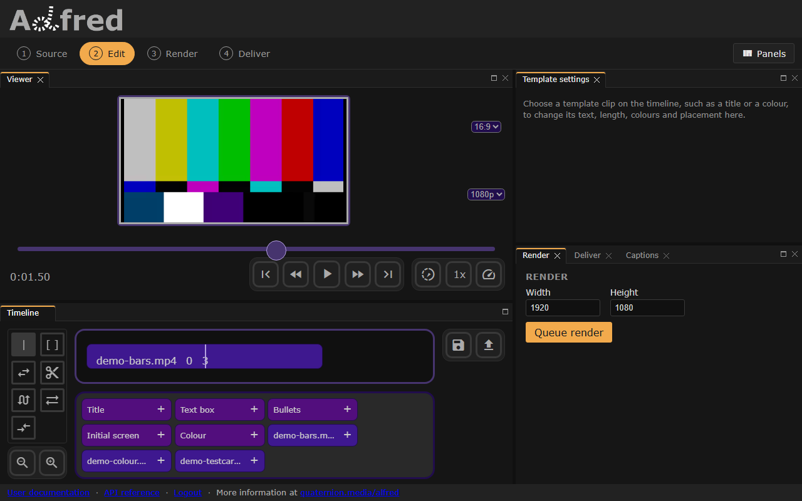

# Adjust clip
## Resize
A video or image is first fitted inside the frame, keeping its proportions, and centred. `resize` scales it from there by the factor given:

- above 1 enlarges the clip
- below 1 shrinks it

``` json title="data.json"
--8<-- "docs/examples/edl/resize.json"
```


*The resize example in the editor: one 3-second clip of the bars. The viewer plays the file as it is; the resize is drawn in a [preview frame](preview.md) or a render.*

## Position
A position of numbers places the clip's top left corner, measured from the frame's top left:

- Larger `x` values move the clip **right**
- Smaller `x` values, down to negative ones, move the clip **left**
- Larger `y` values move the clip **down**
- Smaller `y` values, down to negative ones, move the clip **up**

Each example below first shrinks the clip to half the frame, so where it sits shows.
=== "Absolute"
    With `"relative": false`, `[x, y]` is pixels from the top left. This places the clip 100 pixels from the left and 50 from the top.
    ``` json title="data.json"
    --8<-- "docs/examples/edl/position-absolute.json"
    ```

    

    *The absolute position example in the editor. The viewer plays the file as it is; the size and position are drawn in a preview frame or a render.*
=== "Relative"
    `[x, y]` is in fractions of the frame, where `1` is its width or height. Positions are relative unless the clip says `"relative": false`.
    
    This places the half-size video at the top centre of the frame: its left edge a quarter of the way across.
    ``` json title="data.json"
    --8<-- "docs/examples/edl/position-relative.json"
    ```

    

    *The relative position example in the editor. The viewer plays the file as it is; the size and position are drawn in a preview frame or a render.*
=== "Text"
    Place the clip at `[x, y]` with these words:

    | axis | values |
    | ----- | ----- |
    | x | `left`, `center`, `right` |
    | y | `top`, `center`, `bottom` |
        
    This places it exactly as the relative example does.
    ``` json title="data.json"
    --8<-- "docs/examples/edl/position-words.json"
    ```

    

    *The words position example in the editor. The viewer plays the file as it is; the size and position are drawn in a preview frame or a render.*
