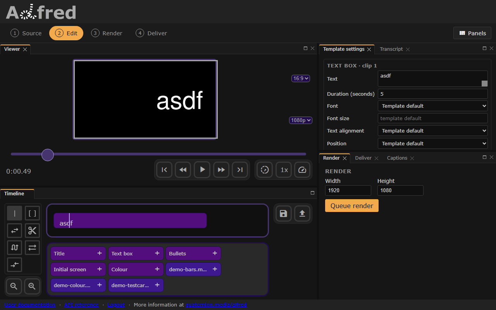

# Animate text

The following generates a text clip which flies in from the right along a 2nd order bezier curve over its first second, according to the following control points, in fractions of the frame:
: c1: `(1,0)`
: a: `(0,0)`
: c2: `(0,1)`
``` json title="Animation" hl_lines="9-21"
--8<-- "docs/examples/edl/animation.json"
```



A curve moves the clip across the frame: only its x coordinates count, unless the curve's `data` also says `"axes": "xy"` or `"y"`. So this clip starts a frame's width to the right and comes to rest after a second where it would otherwise have been. It also fades in over that second, as every clip does unless it says `"fadeIn": 0`.

`bezier2` is the only movement; `textBox`, `initial` and `bullets` take it. `title` takes no `fxs`, and ignores any it is sent.
