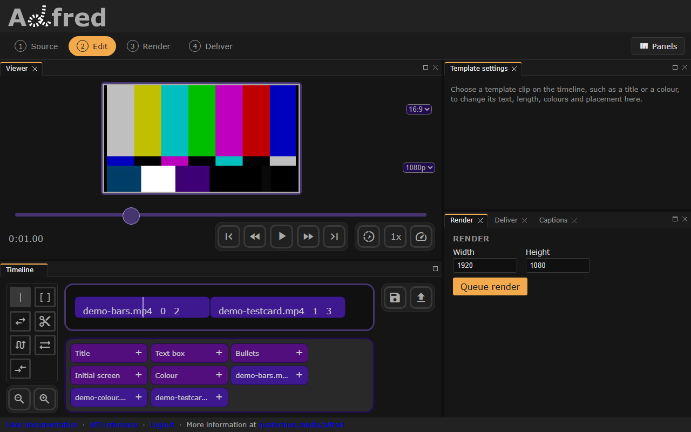

# Combine media
All clips in the `clips` list will be combined to create the finished video. 

`start` sets when each clip begins, in seconds (default 0).

!!! abstract "Rendering order"
    Clips render in list order. Where clips overlap in time, the later one renders above the earlier, with any transparency applied.


``` json title="data.json" hl_lines="14"
--8<-- "docs/examples/edl/combine.json"
```

This makes a 4-second video: two seconds of the colour bars, then seconds 1 to 3 of the test card, starting where the bars end.



*The combine example in the editor: the bars, `0  2`, then the test card, `1  3`, end to end.*
