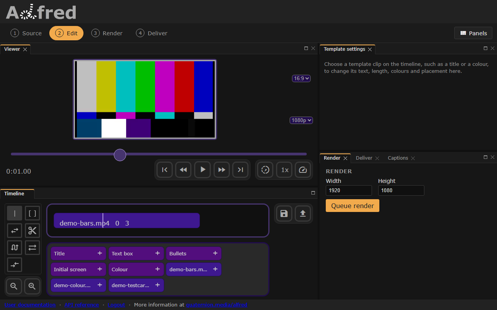

# Fade a clip

A clip fades in and out over one second unless it says otherwise: `fadeIn` and `fadeOut` set the length of each fade in seconds, and `0` turns a fade off. A clip's own fades are the only ones it gets -- templates add none of their own. (The editor sends `0` for both unless a fade was chosen, so its renders cut where the timeline cuts.)

## Fade in
``` json title="fade in" hl_lines="8"
--8<-- "docs/examples/edl/fade-in.json"
```

The bars come up from black over their first two seconds, and fade out over the last, the default.



*The fade in example in the editor, a second in. The viewer plays the file as it is; the fade is drawn in a [preview frame](preview.md) or a render.*

## Fade out
``` json title="fade out" hl_lines="8"
--8<-- "docs/examples/edl/fade-out.json"
```

The bars fade in over their first second, the default, and out to black over their last two.


*The fade out example in the editor, two seconds in. The viewer plays the file as it is; the fade is drawn in a preview frame or a render.*
