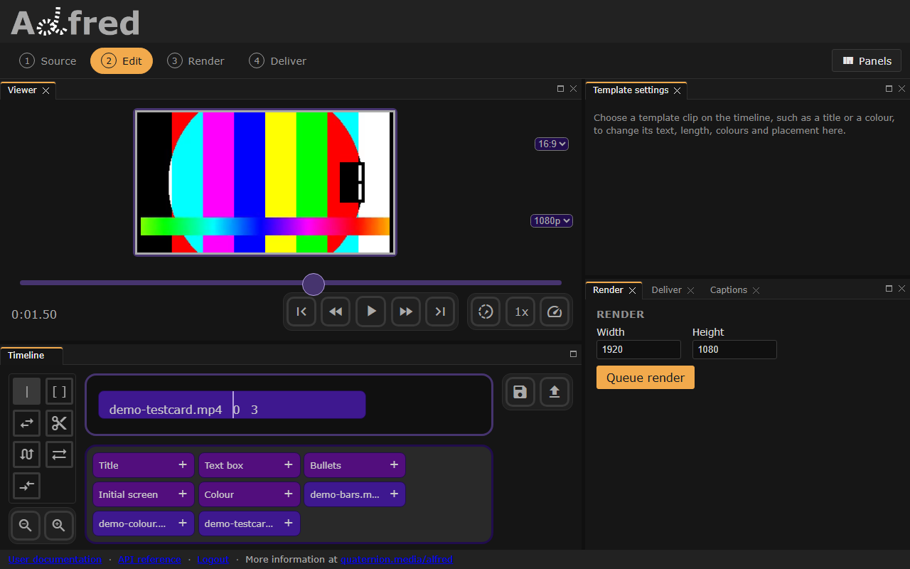

# Add media
All examples here can be previewed or rendered as a full video. A clip's `name` is a file in the server's media library, as `GET /videos` lists it; the [usage notes](index.md) say where the files come from, and what a URL needs instead.

=== "Preview"
    Set `t` to the time to preview, in seconds, and keep the slash in `/preview/`.
    ``` bash title="Preview EDL"
    curl -X POST \
      -H "Authorization: Bearer $TOKEN" \
      -H "Content-Type: application/json" \
      -d @data.json \
      "http://127.0.0.1:8000/preview/?t=1"
    ```
    This answers a signed URL for the frame; [Preview frame](preview.md) says more.

=== "Render"
    ``` bash title="Render"
    curl -X POST \
      -H "Authorization: Bearer $TOKEN" \
      -H "Content-Type: application/json" \
      -d @data.json \
      http://127.0.0.1:8000/render
    ```
    This answers the render's id; see [Render video](render.md).

## Video
A video clip plays its file from the start for `duration` seconds (5 by default), fitted inside the frame with its proportions kept, and centred. Its sound is mixed into the render's.

``` json title="Video source"
--8<-- "docs/examples/edl/video.json"
```



*The video example in the editor: the whole of the test card, `0  3`.*

## Images
An image shows for `duration` seconds, fitted and centred as a video is. `videos/poster.jpg` stands for an image of yours in the library; `GET /media` lists each file with its `kind`.
``` json title="Image source"
{
  "edl": {
    "clips": [
      {
        "type": "image",
        "name": "videos/poster.jpg",
        "duration": 5
      }
    ]
  }
}
```
## Audio
An audio clip is heard, not seen: it is mixed into the render's sound for `duration` seconds (5 by default). A timeline of audio clips alone renders over black. `videos/soundtrack.mp3` stands for an audio file of yours in the library.
``` json title="Audio source"
{
  "edl": {
    "clips": [
      {
        "type": "audio",
        "name": "videos/soundtrack.mp3"
      }
    ]
  }
}
```
