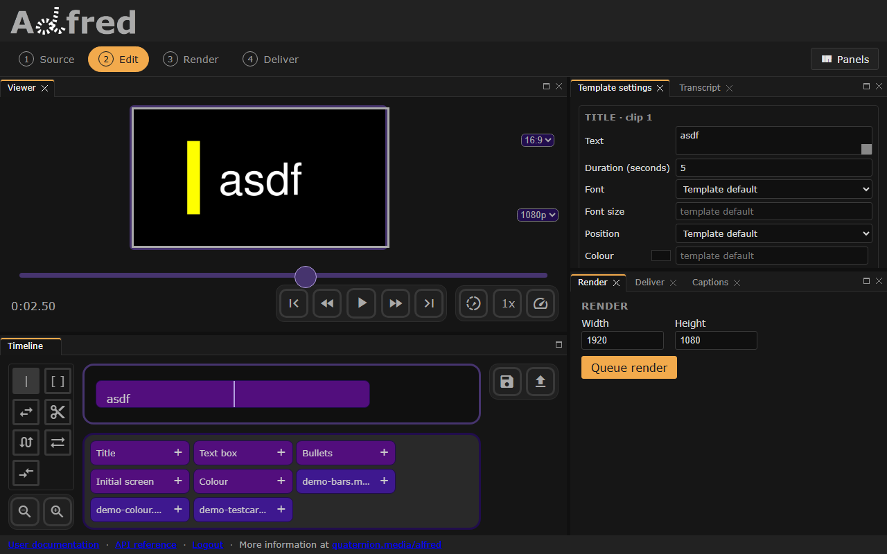
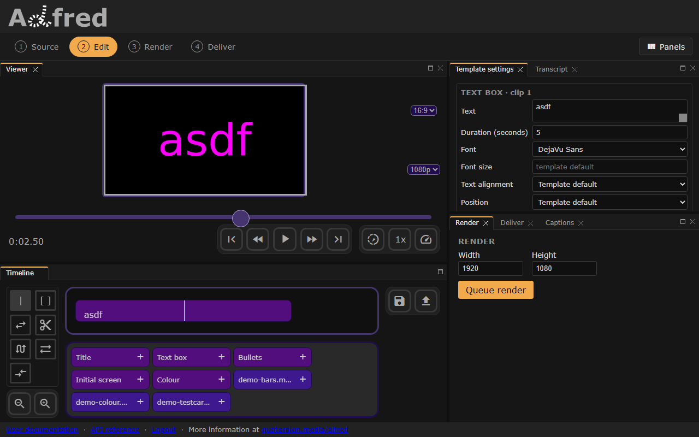

# Generate text

This example posts a single `template` clip that draws `text` in the large `title` format.

!!! note "Preview time"
    `t`, in seconds, is required, and so is the slash in `/preview/`; see [Preview frame](preview.md).

=== "Edl"
    ``` json title="data.json" hl_lines="8"
    --8<-- "docs/examples/edl/title.json"
    ```

=== "Request"
    ``` bash title="Preview template at t=1"
    curl -H "Content-Type: application/json" \
      -H "Authorization: Bearer $TOKEN" \
      -d @data.json \
      "http://127.0.0.1:8000/preview/?t=1"
    ```

## Results

It answers a signed URL for the frame, which works without a session until its `exp`.

```
/preview/frames/6f1c3e0b2a9d4c8e9b7a5d3f1e2c4b6a.jpg?exp=1760793600&sig=Zk8h…
```
{ loading = lazy }

In the editor, the same Edl is one title clip, its text beside the viewer:



*The title example in the editor, its playhead half way through the clip's five seconds, the default length.*

## Properties
Set the text's properties in `data`:

``` json title="data.json" hl_lines="9-10"
--8<-- "docs/examples/edl/textbox.json"
```

`font` is a font name as ImageMagick lists it (`convert -list font` on the server); an unknown name is drawn in the default font, without an error.

## Result

{ loading = lazy }



*The text box example in the editor: the font and colour drawn in the viewer, and set beside it.*

[about/template](../about/template.md) lists every property.
