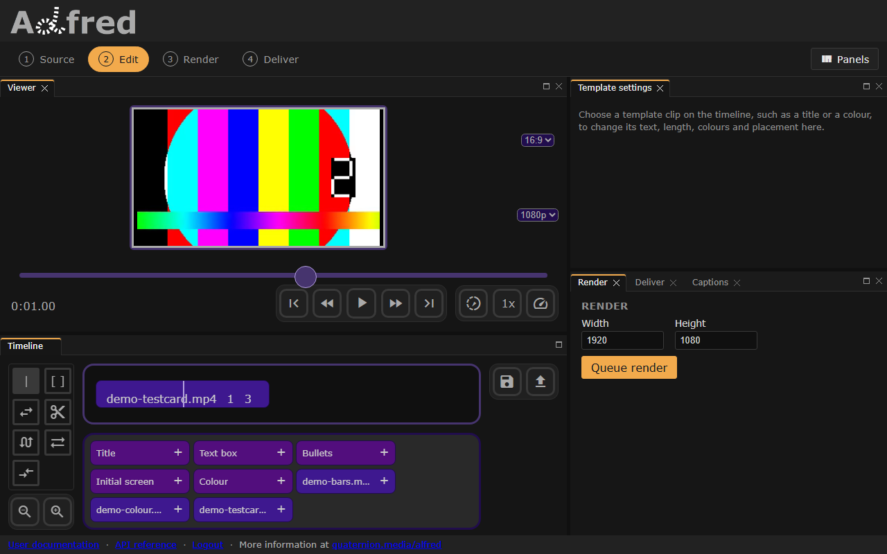

# Trim video
Selecting a portion of a video is as simple as defining an `inpoint`, where in its file the clip starts, and a `duration`, how long it plays from there.

``` json title="data.json" hl_lines="7-8"
--8<-- "docs/examples/edl/trim.json"
```

This Edl makes a 2-second video from the last two seconds of `videos/demo-testcard.mp4`, a 3-second clip: it skips the first second.



*The trim example in the editor. The clip reads `1  3`, its in-point and out-point in the file; a second into the video, the test card's counter shows 2.*
