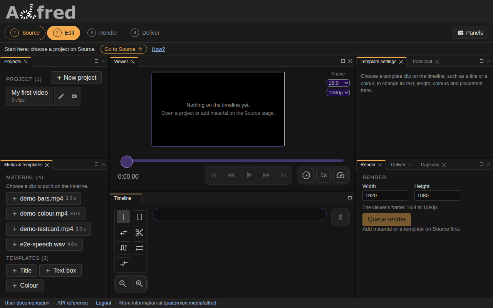
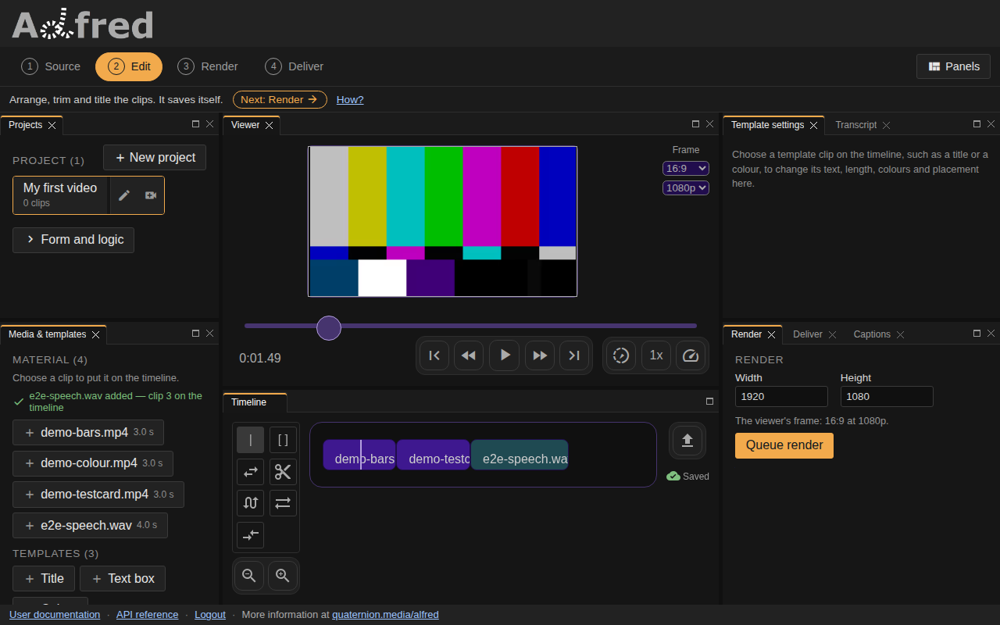
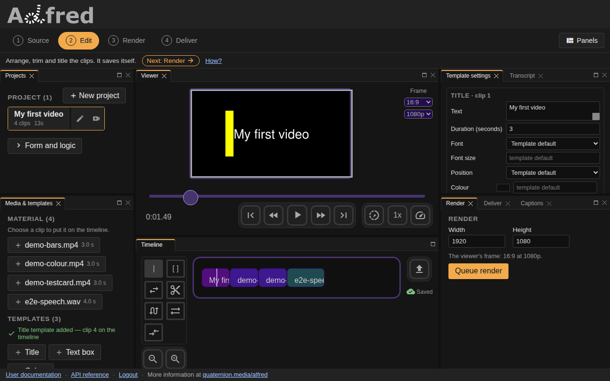
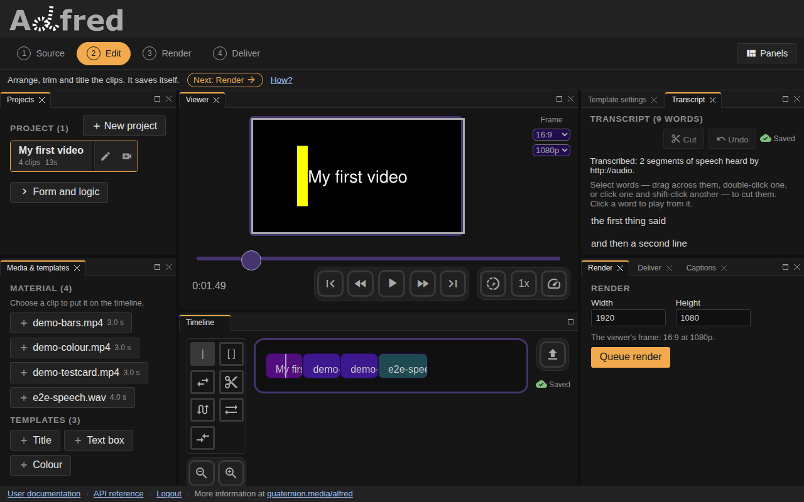
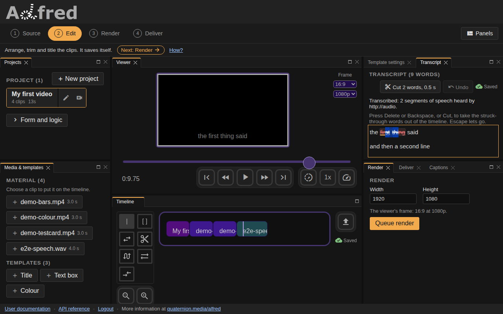
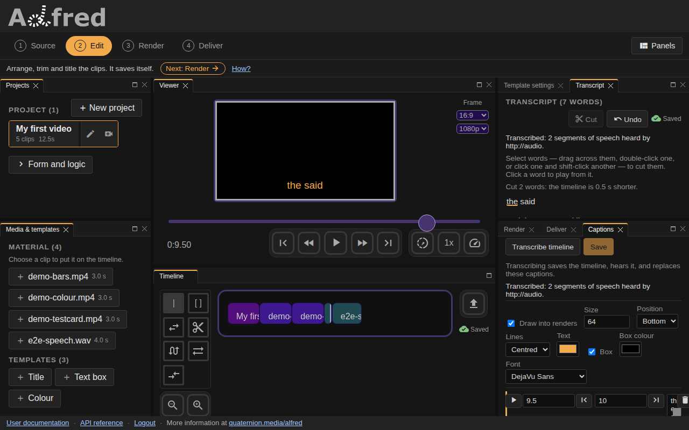
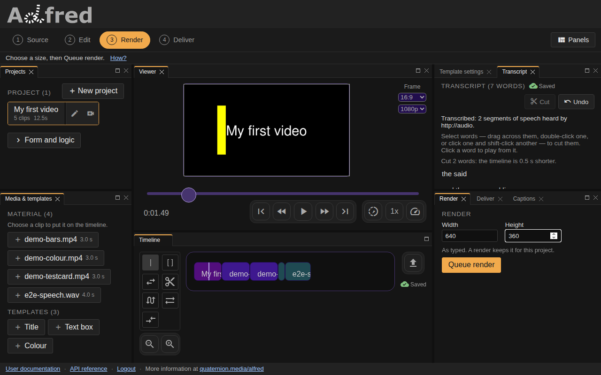
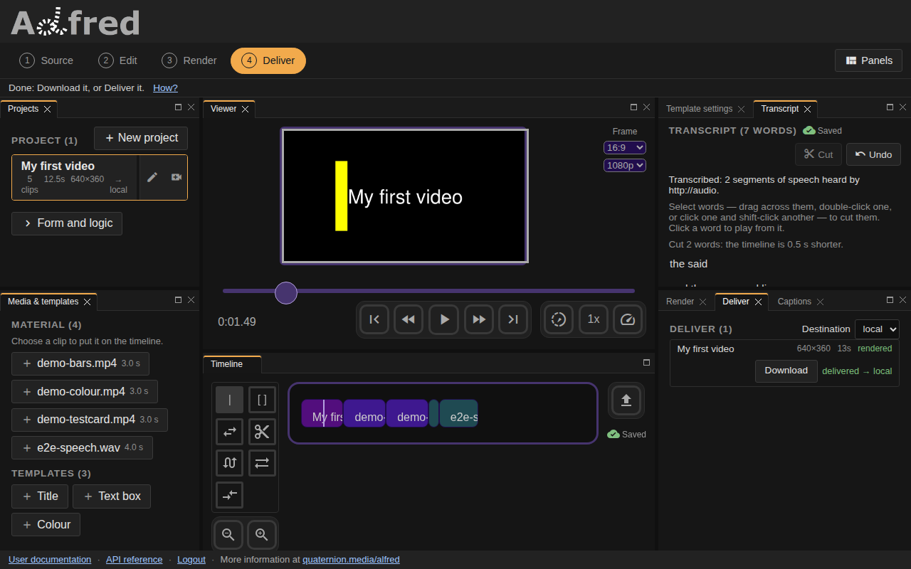

# Make a video with alfred and the QM family

This page makes one video, from nothing to a file you can play, in alfred's
editor, and says which member of the QM family does each part for you. The
pictures are taken by the browser suite as it walks the same steps
(`website/e2e/screens-guide.spec.js`), and the
[cookbook](cookbook.md#recipe-making-a-video) plays a recording of the whole
walk in the docs you serve yourself.

## Who does what

| | What it does for you |
|---|---|
| **alfred** | The editor in your browser, and the server behind it: your projects, their timelines and captions, the renders and where they are sent. |
| **otto** | The picture. It draws the frame the viewer shows of a title or any other template, draws every render, and mixes the timeline's sound when joe is to hear it. It also makes the demo clips, and tells alfred how long each file in the library runs. |
| **joe** | The audio engine. It hears the timeline's sound and says what is said in it, word by word, with when each word was said. |
| **vox** | How alfred reaches joe: the client for an audio engine and the contract it speaks, vendored in alfred. The contract's paths and keys are joe's by default, and settings can name another engine's. |
| **qmcp** | Lets an assistant drive alfred through its `alfred_*` tools: list projects, transcribe and correct captions, render and deliver ([below](#let-an-assistant-drive-it)). |

## 1. Start the family

You need Docker with Compose, git, a POSIX shell for `./al` (Git Bash or WSL on
Windows), and, for joe, [uv](https://docs.astral.sh/uv/) and ffmpeg.
[Get started](start.md#what-you-need) has the detail. Clone alfred, and joe
beside it:

```sh
git clone --recurse-submodules https://github.com/quaternionmedia/alfred.git
git clone --branch docs/tighten-language https://github.com/quaternionmedia/joe.git
cd alfred
./al init
ALFRED_DEV_SKIP_AUTH=1 ./al family up
```

`./al family up` starts the family in one command: joe's API on port 8010,
then alfred's dev stack (the site, the api, a render worker and the database)
pointed at it. It says where each one is:

```text
$ ALFRED_DEV_SKIP_AUTH=1 ./al family up
joe: starting from /home/you/src/joe on 127.0.0.1:8010 (log: .family/logs/joe.log)
alfred: ./al dev -d, audio engine http://host.docker.internal:8010
…
alfred  http://127.0.0.1:8000   (docs: ./al docs; smoke: ./al family smoke)
joe     http://127.0.0.1:8010
qmcp    QMCP_ALFRED_URL=http://127.0.0.1:8000 for its alfred tools
```

*What `./al family up` prints, the stack's own output abridged.*

The media API alfred asks joe through is on that branch of joe, its pull
request #35, until it merges; `./al family up` warns when the joe it finds has
none. joe is found beside alfred's checkout, or wherever `ALFRED_FAMILY_JOE`
names:
`ALFRED_FAMILY_JOE=../joe.worktrees/media ./al family up`. A joe already
answering on 8010 is used as it is. `ALFRED_DEV_SKIP_AUTH=1` skips the login
and serves you as a development account, on this machine only ([Skipping login
in development](dev-auth.md)); leave it off to register and log in instead.
`./al family smoke` then checks every part of the path, and
[the family dev loop](family.md) says more about each.

## 2. Open the editor



*The editor as it opens, with nothing chosen yet.*

Browse to <http://127.0.0.1:8000>. The editor is one page. The rail along its
top names the four stages a video goes through, Source, Edit, Render and
Deliver. On a screen 1024 pixels wide or more every panel is open at once: the
projects and the material on the left, the viewer over the timeline in the
middle, and on the right the selected clip's settings and the Transcript above
the Render, Deliver and Captions tabs. On a phone the editor shows one stage at
a time above the viewer and the timeline.

## 3. Bring your media



*Material chosen in the order it should play: colour bars, a test card and a sound.*

Choose **Source** on the rail. Under **Projects**, choose the project to make
the video in. An account with none is offered **Generate a demo project**,
which makes one called Demo with a title, a text box and a colour field on its
timeline. The pictures here start from a project with nothing on it yet.

**Material** lists the server's media library, each file with how long it
runs where the server can tell. On an empty library, **Generate demo media**
has otto make three short clips, colour bars, a test card and a colour field,
with no network. Your own
files go into the `videos/` directory of alfred's checkout, which is the
library; reload the page and they are listed. Choose a file to put it on the
end of the timeline. To be transcribed, the video needs sound: the demo clips
are silent, so the pictures here add a sound file after them.

## 4. Arrange the timeline and add a title



*The title, moved to the front with the Move tool, its text typed in Template settings.*

**Templates**, under Material, are clips made rather than filed: choose
**Title** to put one on the end. Its settings open on the right: type its
text, and its length as **Duration**. The viewer shows the frame otto draws
of it.

The tools in the column beside the timeline change the clips. Choose **Move**
(the two arrows) and drag the title to the front. **Trim** drags a clip's end,
**Cut** splits one in two, and **Slip**, **Slide** and **Dual roller** shift
what a clip plays, where it sits and where a cut falls; [Editing
tools](tools.md) shows each one.
Choose **Time** again, and a press on a clip puts the playhead there.

Then press the disk icon beside the timeline. It saves the timeline to the
project, and the next step hears the saved timeline.

## 5. Transcribe the sound with joe



*The Transcript once the sound is heard: a paragraph to each stretch of speech.*

Open the **Transcript** tab, beside Template settings, and press **Transcribe
timeline**. alfred has otto mix the saved timeline's sound, sends it through
vox to joe, and joe says what is said in it and when. The words come back as
the transcript, and as captions timed to them. The panel says when it is done
and how many stretches of speech were heard.

The button waits, and says why, while the server is checking the audio engine,
when no engine is configured or answering, or when no render worker is running
to mix the sound. On a CPU, joe's first transcription after it starts takes
about 18 seconds, loading its speech model (whisper's `base`, downloaded once
if it is not already there); after that, about as long as the speech.

## 6. Edit by text



*Two words selected: what a cut would take is struck through before it goes.*

Select words in the transcript as you would any text: drag across them,
double-click one, or click one and shift-click another. The words a cut would
take are struck through, and **Cut** says how many and how long they last.
Press **Delete**, **Backspace** or **Cut**: the stretch they were said in is
cut from the timeline, picture and sound alike, everything after it moves up,
and the captions move with it. **Save** keeps the cut. Click a word to put the
playhead where it starts.

On a phone the Edit stage shows Captions, and a switch at its top chooses
**Transcript** instead. [Editing by text](captions.md#editing-by-text) has the
rules of a cut.

## 7. Style the captions



*The captions styled and saved; the caption under the playhead is drawn as a render will draw it.*

Open the **Captions** tab, beside Render and Deliver. A cut does not rewrite a
caption's text, so a caption that said a cut word still says it: correct it in
its row. Tick **Draw into renders**, which is off until you do, and choose the
size, the position, how lines align, the text colour, a box behind the text
and its colour, and the font. **Save** keeps the captions and their style.

The caption under the playhead shows over the viewer in its style, faint while
it is not drawn into renders. Captions can also be typed (**Add at playhead**)
or imported from a SubRip, WebVTT or JSON file: [Captions](captions.md).

## 8. Render



*The Render stage, at 640 by 360.*

Choose **Render** on the rail. **Width** and **Height** start at the size the
project last rendered at, or else the viewer's; a smaller one makes a smaller
file sooner. Press **Queue render**. The server queues it for its render
worker, where otto draws every frame of the timeline as it stands, saved or
not, with the captions over it once **Draw into renders** is ticked, and mixes
its sound. The editor moves on to Deliver.

## 9. Deliver



*The render finished and delivered to `local`.*

The **Deliver** panel follows the render from `queued` to `rendering`, with its
progress, to `rendered`. Then **Download** saves the video through your
browser, and **Deliver** sends it to the **Destination** chosen above the list:
`local` copies it into the `deliveries/` directory of alfred's checkout. If the
panel says no renderer is running, the render waits in the queue until a
worker starts.

When you are done, `./al family down` stops the dev stack, and joe if `up`
started it.

## Let an assistant drive it

qmcp is QM's tool server. Pointed at alfred, it publishes nine tools an
assistant can call:

| Tool | What it does in alfred |
|---|---|
| `alfred_projects`, `alfred_templates` | lists the projects the account can see, and the templates a clip can be made from |
| `alfred_captions_transcribe` | has joe transcribe a project's saved timeline, as step 5 does |
| `alfred_captions`, `alfred_captions_set` | reads a project's captions, style and last transcription; stores corrected captions or a new style, as step 7 does |
| `alfred_render_enqueue`, `alfred_render_status` | queues a render of a project's saved timeline, with its captions when their style is on, and follows it to a download link |
| `alfred_render_deliver` | sends a finished render to a destination, as step 9 does |
| `alfred_health` | alfred's report on itself: its database, render workers, queue and audio engine |

Bringing media, arranging the timeline and editing by text are the editor's
alone: no tool does them. To connect an assistant, in qmcp's checkout set
`QMCP_ALFRED_URL` to the address `./al family up` printed, start the server
with `uv run qmcp serve`, and point an MCP client such as Claude Code at
`qmcp_mcp.py`, which lists and invokes the running server's tools. A stack
started with `ALFRED_DEV_SKIP_AUTH=1` needs no account; otherwise set
`QMCP_ALFRED_EMAIL` and `QMCP_ALFRED_PASSWORD` to one. qmcp's
`docs/integrations/alfred.md` is the reference.

Against a running stack, `./al family smoke` calls `alfred_health` through the
qmcp checkout beside alfred's. qmcp's own tests drive the other tools against
a stand-in alfred.

## The walk, recorded

The steps above are one browser test, `recipe: make a video from start to
finish` in `website/e2e/recipes.spec.js`, which `./al recipes` records. To
bring the family up, record every walkthrough, retake every picture and leave
the stack up to try:

```sh
ALFRED_DEV_SKIP_AUTH=1 ./al loop --only recipes --keep --joe ../joe
./al docs
```

`./al docs` then serves these pages at <http://127.0.0.1:4000>, where the
[cookbook](cookbook.md#recipe-making-a-video) plays each recording. The
recording runs Playwright on this machine, so `website/` needs its
dependencies and a browser first: `yarn install` and `npx playwright install
chromium` there.

The walk's sound is `videos/e2e-speech.wav`, two bursts of tone that the
browser suite's stand-in engine takes for speech. joe listens for real speech:
put a file with some in `videos/` and name it, `E2E_SPEECH=videos/talk.mp4`
before `./al loop`. Without the file, the walk is skipped and its pictures are
left as they were. [The test loop](loop.md) has the rest of `./al loop`.
