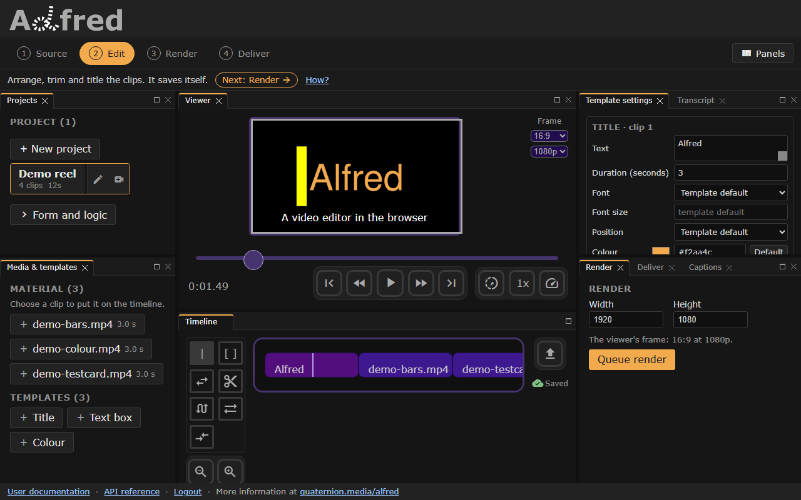
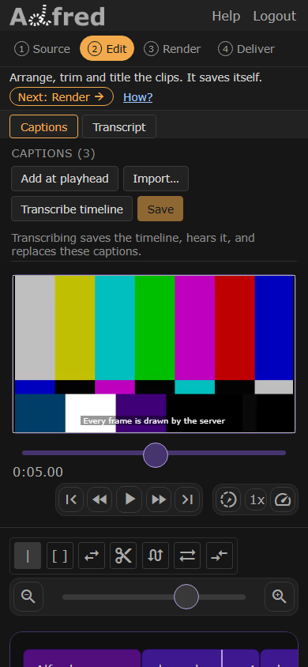
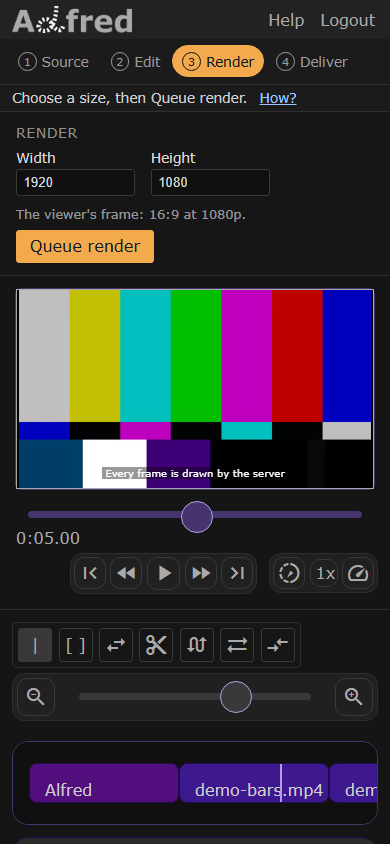

# Alfred

  

*The editor on a wide screen, as a workspace of panels, and on a phone, one stage at a time: Edit, then Render.*

Alfred is a browser video editor for quick editing from anywhere, mobile
devices included. The browser edits the timeline; every preview and render is
made by an Alfred server you run yourself, with cloud storage optional.

The editor is one page, worked in four stages named on the rail along its top:

1. **Source**: choose a project, and the media and templates for its timeline.
2. **Edit**: arrange, trim, cut, slip and slide the clips with the tools beside
   the timeline, and set a title's text, length and colours.
3. **Render**: choose the output's size and queue a render, which the server
   makes.
4. **Deliver**: follow the render until it is finished, then download it or send
   it to a destination.

Beside them, **Captions** are typed, imported from a subtitle file, or
transcribed from the timeline's sound, and drawn into renders. Once the sound
is transcribed, the **Transcript** edits the video by what is said in it:
delete words, and the stretch they were said in is cut out. On a screen 1024
pixels wide or more, the panels are a workspace you can rearrange, with a
Panels menu to bring back a closed one; narrower, as on a phone, the editor
shows one stage at a time above the viewer and the timeline, and at Edit a
switch chooses Captions or the Transcript.

## Start here

1. [Get started](start.md): run Alfred on your own machine and make a first
   video, from Source to Deliver.
2. [User journeys](journeys.md): what you came to do, from a first video to
   captions, a phone and an account, each walked through the editor. The
   editor's own **How?** links open them.
3. [Make a video with alfred and the QM family](guide.md): one video from
   nothing to a delivered file, transcribed by joe and cut by its words, with
   what each member of the family does for you.
4. [Cookbook](cookbook.md): every behaviour of the editor, step by step,
   generated from the browser tests that check them.
5. [Captions](captions.md) and [Configuration](configuration.md): captions in
   the editor and through the API, and every setting the server reads.
6. [Concepts](about/index.md): clips, templates, timelines, projects and
   renders. [Examples](examples/index.md) and the [API](api/index.md) make
   videos without the editor, with `curl`.

## How it is built

A small control plane, `alfred`, owns accounts, projects, renders, captions
and their orchestration, and hands the media work to two engines: otto draws
every preview frame and render and mixes the timeline's sound, and vox drives
an audio engine such as joe over HTTP, which transcribes captions from that
sound. qmcp, QM's tool server, lets an assistant drive alfred through its
`alfred_*` tools. [The family dev loop](family.md) runs them together.

!!! quote "Alfred Hitchcock"
    Drama is life with all the dull bits cut out.

## Links
App: [alfred.quaternion.media](https://alfred.quaternion.media)

Documentation: [alfred.quaternion.media/docs/](https://alfred.quaternion.media/docs/)

API Reference: [alfred.quaternion.media/api](https://alfred.quaternion.media/api)

Source code: [github.com/quaternionmedia/alfred](https://github.com/quaternionmedia/alfred)
