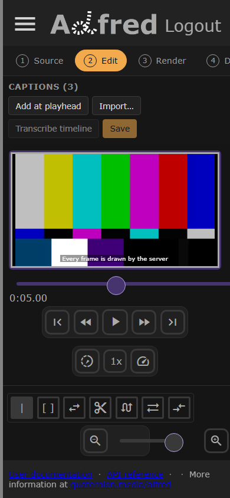
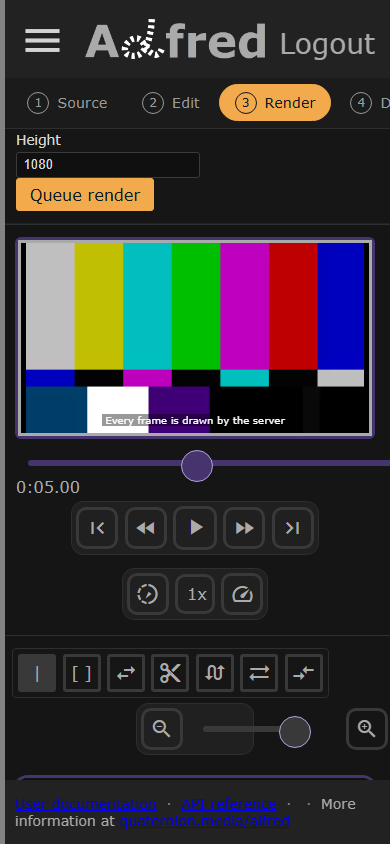

# Alfred

  

*The editor on a wide screen, as a workspace of panels, and on a phone, one stage at a time: Edit, then Render.*

Automatic video tools

{ loading=lazy width=200em style="background-color:#2E303E; border-radius: 1em;" }

## Overview

Alfred is a web-based video editing suite that simplifies production with cloud-based tools.

## Features
### Rendering
- Server-based rendering
    - Optional: add an existing physical or virtual server as a rendering node
- Cloud monitoring of render status
- Secure file storage and downloads
### Editing
- Create and modify edits in any HTML5 browser
- No powerful editing hardware needed
- Works on mobile devices
<!-- - Drag and drop clips to rearrange -->
- Preview the finished product in the browser
- Render final videos in the cloud
- Output to different resolutions and formats
  <!-- - Advanced (multi-track) -->
### [Templates](about/template.md)
- Define dynamic `Templates` for clips
- Create forms for end users to customize a video from a Template
- Apply `fx` to clips for text and video animations
### Forms
- Design simple forms that put end users' data into templates
- Define dynamic properties that pull from multiple sources

## Origin
Alfred began as a simple, serverless video client: modern web browsers in front of a powerful, scalable rendering engine. It has grown into a suite of video and editing tools, including rendering, template generation and automations.

!!! quote "Alfred Hitchcock"
    Drama is life with all the dull bits cut out.

    
## Links
App: [alfred.quaternion.media](https://alfred.quaternion.media)

Documentation: [alfred.quaternion.media/docs/](https://alfred.quaternion.media/docs/)

API Reference: [alfred.quaternion.media/api](https://alfred.quaternion.media/api)

Source code: [github.com/quaternionmedia/alfred](https://github.com/quaternionmedia/alfred)
