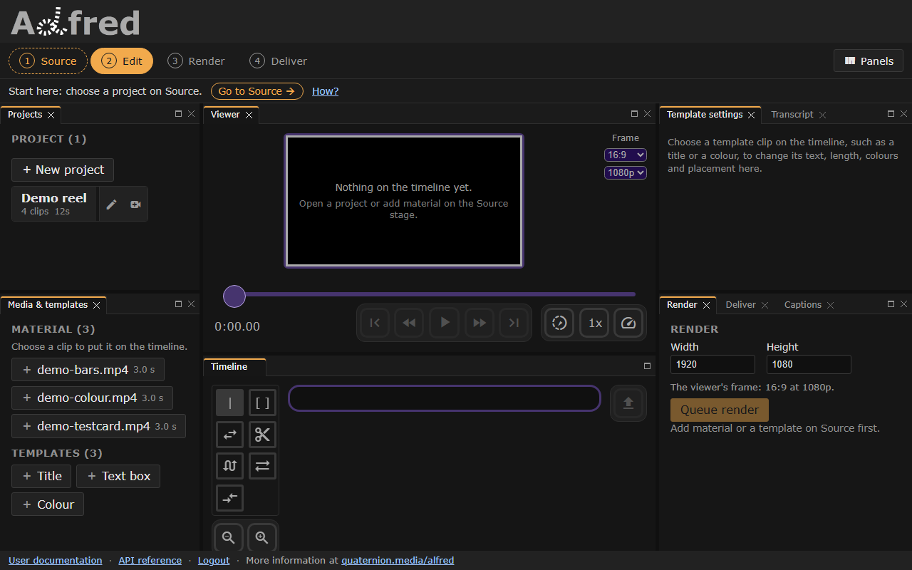
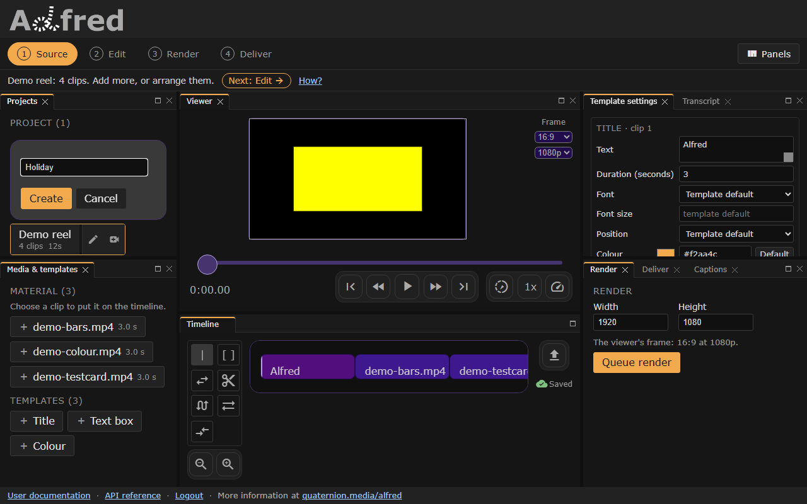
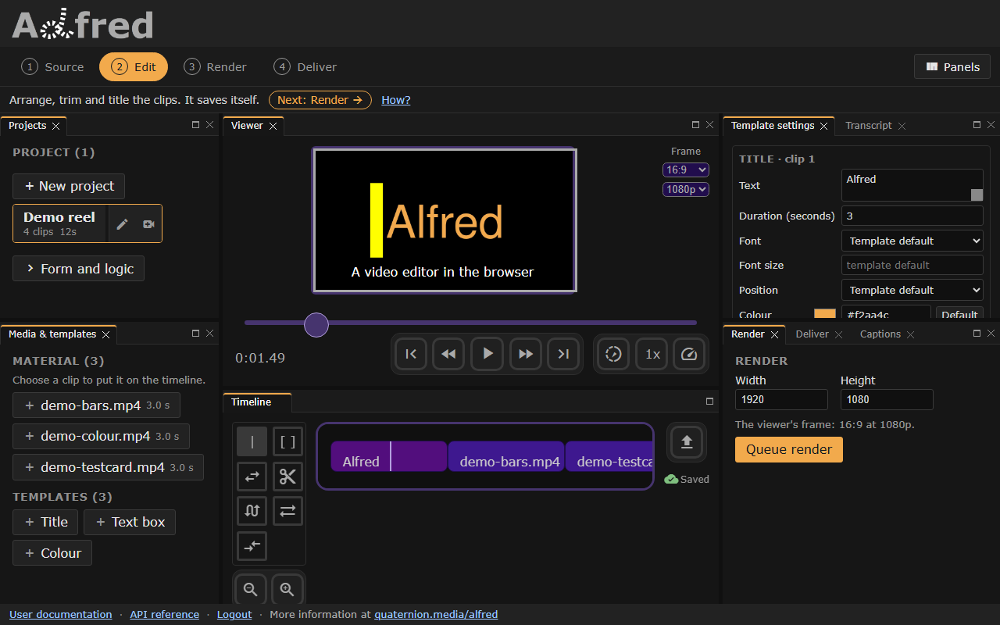
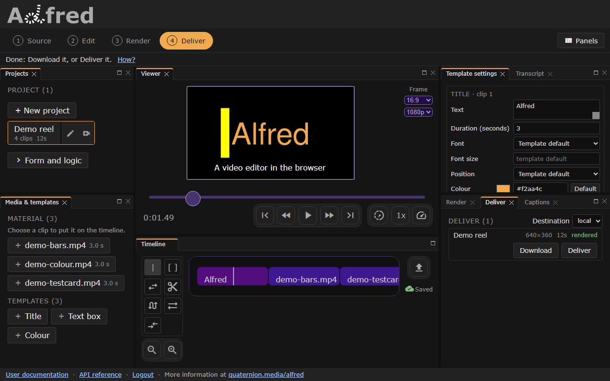
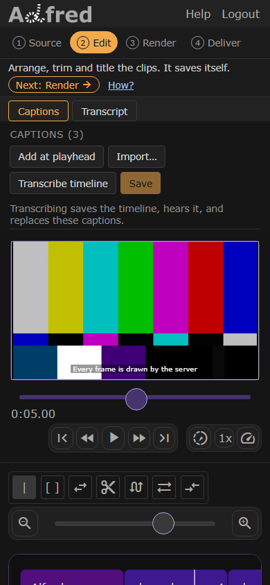

# User journeys

Each journey here starts from something you came to do, and walks the editor
to it: where to press, and what you see when it worked. In the editor, the
line under the stage rail says the next step as you go, and its **How?** opens
the journey that step belongs to, on this page. **Help**, at the top of the
editor on a phone, opens this page too.

The browser suite walks every journey, and each one names the specs that go
red when it stops working ([The browser suite](cookbook.md)). In docs served
locally after `./al recipes`, the recorded walkthroughs play here, each under
the journey it walks.

| To do this | Follow | What it needs |
|---|---|---|
| See a video made from start to finish, in a few minutes | [A first video](#first-video) | the editor, nothing else |
| Make a video from your own footage | [Your own footage](#your-own-footage) | your files in the server's library |
| Arrange the clips, trim them, and put a title on | [Arrange and title](#arrange-and-title) | a project with clips |
| Get the finished file | [Render and deliver](#render-and-deliver) | a render worker, which the dev stack runs |
| Make the same kind of video again, with new words | [From a form](#from-a-form) | a project with a form, such as **Announcement** |
| Caption it, or cut it by deleting words | [Captions and cutting by words](#captions-and-cutting-by-words) | an audio engine, such as joe |
| Edit on a phone | [On a phone](#on-a-phone) | |
| Pick up where you left off | [Coming back](#coming-back) | |
| Make an account and log in | [An account](#an-account) | a server that takes registrations |
| Have an assistant do it | [With an assistant](#with-an-assistant) | qmcp |

[Get started](start.md) runs the editor on your own machine first, if it is
not running yet.

## The editor in one look

The rail along the top names the four stages a video goes through:

1. **Source**: choose a project, and the material that goes on its timeline.
2. **Edit**: arrange the clips, trim and cut them, and set a title's text.
3. **Render**: choose the output's size, and have the server make the video.
4. **Deliver**: follow the render, then download it or send it on.

On a screen 1024 pixels wide or more, every panel is open at once, and
choosing a stage brings its panels forward: the projects and the material on
the left, the viewer over the timeline in the middle, and on the right the
selected clip's settings, the Transcript, and the Render, Deliver and
Captions tabs. A panel closed by its ✕ comes back from the **Panels** menu.
On a phone the editor shows one stage at a time above the viewer and the
timeline.

Under the rail, one line says where you are and what comes next, with a
button to the next stage. With no project open, **Source** on the rail has a
dashed outline: that is where to start.

<!-- recipe: open the editor and look around -->

*Checked by `workspace.spec.js`, `stacked.spec.js` and `journeys.spec.js`.*

## A first video { #first-video }

*With no project open: Source is outlined, and the line under the rail says where to start.*

Nothing to bring: the server makes the project and its pictures.

<!-- recipe: generate a demo from an empty install -->

1. Open the editor. The line under the rail says **Start here**. Press **Go
   to Source**.
2. Under **Projects**, choose **Timeline demo**. If the list is empty, as it
   is for a new account, press **Generate a demo project**, which makes one
   called **Demo**. It opens with a title, a text box and a colour field on
   the timeline.
3. Press play under the viewer to watch it. Every frame is drawn by the
   server.
4. Press **Next: Render** on the line under the rail, then **Queue render**.
5. The editor moves on to Deliver, where the render goes from `queued`, to
   `rendering` with its progress, to `rendered`. Press **Download**.

It worked when the browser saves a video file as long as the timeline. If the
render stays `queued`, see [When something goes wrong](#when-something-goes-wrong).

*Checked by `demo.spec.js` and `deliver.spec.js`.*

## Your own footage { #your-own-footage }

1. Put your files in the server's library. On a server you run, that is the
   `videos/` directory of alfred's checkout. Reload the editor, and
   **Material**, in the Media & templates panel, lists each file with how
   long it runs. To practise first, **Generate demo media** on an empty
   library makes three short clips.
2. On **Source**, press **New project** (on a phone, the **+** beside the
   filter), type a name, and press **Create**. The project opens, empty.

   

   *New project, named and ready to create.*

3. Under **Material**, choose a file to put it on the end of the timeline. A
   line under the list says where it landed. Choose the next, in the order
   they should play.
4. Press **Next: Edit**, and go on to [Arrange and title](#arrange-and-title).

There is nothing to save: the timeline saves itself ([Saving](#saving)).

*Checked by `editor-media.spec.js` and `journeys.spec.js`.*

## Arrange and title { #arrange-and-title }

*At Edit: the title's settings on the right, and Saved beside the timeline.*

<!-- recipe: choose a project and edit its timeline -->

1. Under **Templates**, in the Media & templates panel, choose **Title** to
   put a title card on the end of the timeline. Its settings open on the
   right, **Template settings**: type its text, and its length as
   **Duration**. The viewer shows the frame the server draws of it. **Text
   box** and **Colour** work the same way.
2. The column of tools beside the timeline changes the clips. Choose
   **Move** (the two arrows), and drag the title to the front. **Trim**
   drags a clip's end, **Cut** splits one in two (**S** splits at the
   playhead), and **Slip**, **Slide** and **Dual roller** shift what a clip
   plays, where it sits, and where one clip gives way to the next. [Editing
   tools](tools.md) shows each one.
3. Choose **Time** again, and a press on a clip puts the playhead there.
4. Press play to watch it through. When it plays as it should, press **Next:
   Render**.

The magnifiers under the tools zoom the timeline. The **Frame** menus beside
the viewer set the picture's shape (16:9, or 9:16 for a phone's screen) and
how sharp it is drawn; a project's first render starts at that size.

<!-- recipe: pick a tool and move the playhead -->

*Checked by `templates.spec.js`, `timeline-tools.spec.js` and `tools.spec.js`.*

## Render and deliver { #render-and-deliver }

*A finished render, ready to download or deliver.*

<!-- recipe: render the timeline and deliver the result -->

1. On **Render**, **Width** and **Height** say the output's size, and the
   line under them says where it came from: the size this project last
   rendered at, the viewer's frame, or what was typed. A smaller size makes a smaller file
   sooner; 640 by 360 is quick to try.
2. Press **Queue render**. The server renders the timeline as it is on the
   screen, with the captions over it once they are drawn into renders, and
   the editor moves on to Deliver. Editing can go on meanwhile.
3. **Deliver** follows the render from `queued`, to `rendering` with its
   progress, to `rendered`.
4. Press **Download** to save the video through the browser, or choose a
   **Destination** and press **Deliver** to send it there. `local` copies it
   into the `deliveries/` directory of alfred's checkout.

It worked when the render's row says `rendered` and the download plays.

*Checked by `editor-render.spec.js`, `deliver.spec.js` and `render-pipeline.spec.js`.*

## From a form { #from-a-form }

A project with a form makes its video from what is typed into the form.
**Announcement**, which a new install starts with, is one: a headline, its
details and the fine print over a background.

1. Under **Projects**, choose **Announcement**, and press **Render** on the
   stage rail. The Render stage shows the project's form.
2. Type a **Headline**, the **Details** and the **Fine print**. Choose how the
   details align, how many **Seconds** it runs, and the **Background** and
   **Text** colours.
3. Drag the slider under the form to a moment, and press **preview** for the
   frame the server draws there.
4. Press **render**. The editor moves on to Deliver, as for any render.

It worked when the preview shows the words typed, and the video runs the
seconds chosen. [Project](about/project.md) says how to write a form of your
own.

*Checked by `editor-render.spec.js`.*

## Captions and cutting by words { #captions-and-cutting-by-words }

These need an audio engine on the server, such as joe; the dev stack alone
has none, and `./al family up` starts joe with it ([Make a
video](guide.md#1-start-the-family)). The timeline needs sound: a file with
speech in it.

1. Open the **Transcript** tab, beside Template settings, and press
   **Transcribe timeline**. It saves the timeline, and the server hears its
   sound. The words come back as the transcript, and as captions timed to
   them.
2. Select words in the transcript as you would any text, and press
   **Delete**: the stretch they were said in is cut from the timeline,
   picture and sound alike, and the captions move with it. **Ctrl+Z**
   (**Cmd+Z** on a Mac), or **Undo**, takes the cut back.
3. Open the **Captions** tab. Correct a caption's text in its row, tick
   **Draw into renders**, choose the size, position, colours and font, and
   press **Save**: captions typed by hand have their own Save.
4. Go on to [Render and deliver](#render-and-deliver). The render draws the
   captions over the picture.

Captions can also be typed (**Add at playhead**) or imported from a SubRip,
WebVTT or JSON file. [Captions](captions.md) has every rule, and [Make a
video with alfred and the QM family](guide.md) walks all of it with
pictures.

<!-- recipe: import captions and show them over the picture -->

<!-- recipe: cut the video by deleting words from its transcript -->

*Checked by `captions.spec.js` and `transcript.spec.js`.*

## On a phone { #on-a-phone }

*Edit on a phone: one stage at a time, above the viewer and the timeline.*

The same journeys, one stage at a time. The rail is at the top, the line
under it says what comes next, and the stage's own panels sit above the
viewer and the timeline. At Edit, a switch chooses **Captions** or
**Transcript**. The selected title's settings are beside the viewer. **Help**
and **Logout** are at the top right, beside the logo. To try it from a phone
on the same network as a dev stack, see the [dev-server notes](dev-server.md).

*Checked by `flow.spec.js` and `stacked.spec.js`.*

## Coming back { #coming-back }

A project keeps its timeline, its captions, and the size it last rendered at.
Open the editor, choose the project under **Projects**, and it opens where it
was saved. The address names the project and the stage, so a bookmark or a
reload lands there too.

If you left before an edit had saved, or a save failed, the editor offers
the edit back above the panels: **Restore them** puts it on the screen and it
saves itself, **Discard** keeps what was saved. What is kept belongs to the
browser tab, and goes with it.

*Checked by `flow.spec.js` and `editor-draft.spec.js`.*

## Saving { #saving }

The timeline saves itself a second after it stops changing. The indicator
beside the timeline, and in the Transcript panel, says **Saving…**, then
**Saved**. When a save fails it says **Not saved**, with the reason when you
point at it, and a **Retry**; it tries again by itself too, and keeps the edit
in the tab meanwhile. Opening another project saves the one you are leaving.
Captions typed or styled by hand are saved with the Captions panel's
**Save**. [Editing by text](editing-by-text.md#saving) has the detail.

*Checked by `autosave.spec.js`.*

## An account { #an-account }

A server run with `ALFRED_DEV_SKIP_AUTH=1` skips this: everyone is a
development account, on that machine only ([Skipping login in
development](dev-auth.md)). Otherwise:

1. On the login screen, type your email address and a password of at least
   eight characters, and press **Create an account**. It asks your first
   name.
2. Press **Log in**.
3. **Forgot password** mails a link to choose a new one, to the address typed
   in.

A server in production takes registrations only when its operator opens
them, and says so when it does not.

*Checked by `login.spec.js` and `session.spec.js`.*

## With an assistant { #with-an-assistant }

qmcp, QM's tool server, lets an assistant list projects, transcribe and
correct captions, render and deliver. Arranging the timeline is the
editor's alone. [Let an assistant drive it](guide.md#let-an-assistant-drive-it)
says how to connect one.

*Checked in qmcp, whose tests drive its tools against a stand-in alfred.*

## When something goes wrong { #when-something-goes-wrong }

| What you see | What it means, and what to do |
|---|---|
| The render stays `queued`, and Deliver says no renderer is running | Nothing is there to render it. `./al dev` starts a render worker with the stack; the render waits in the queue until one runs. |
| The render says `failed` | Its row says why. Change the timeline on Edit, and render again. |
| **Not saved** beside the timeline | The save did not reach the server; point at it for why. The edit is kept in this tab, and it tries again; **Retry** tries at once. A caption marked in the Captions panel holds a save back until it is fixed. |
| **Transcribe timeline** is greyed out | It says why when you point at it: no audio engine is configured or answering, or no render worker is running to mix the sound. |
| **Material** is empty | The library has no files. Put some in `videos/`, or press **Generate demo media**. |
| The page shows the login screen again | The session ran out. Log in; the editor goes back to the project, and offers back anything not saved. |

*Checked by `health.spec.js`, `deliver.spec.js` and `editor-draft.spec.js`.*
