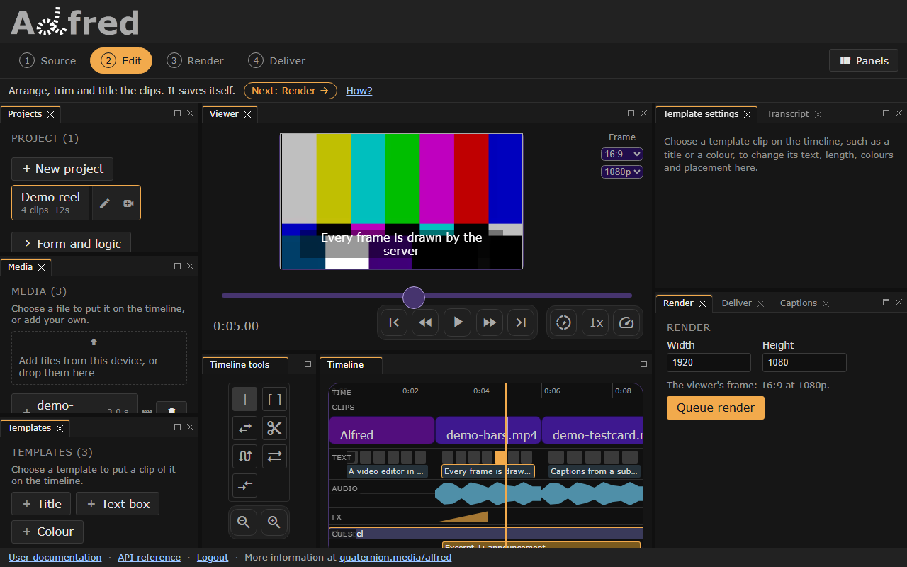

# The timeline's lanes



*One time axis, six lanes: what is at a second in one lane is above and below what is at that second in the others.*

The Edit stage's timeline is a set of lanes on one time axis, at one scale,
in one box that scrolls sideways. The clips are one lane of it, and the
tools act on them as they always did ([Editing tools](tools.md)); the lanes
under them show what the editor knows about the same seconds, so a cut can be
placed by what is said, by how loud it is, and by what has been marked, as
well as by the picture.

| Lane | What it shows | Where it comes from |
|---|---|---|
| **Time** | a labelled tick every so many seconds, for the zoom: every two seconds at the usual zoom, every tenth zoomed right in, every few minutes zoomed right out | the timeline's length and the zoom |
| **Clips** | the clips, end to end, each as wide as it is long | the project's timeline |
| **Text** | each word of the transcript where it was said, and under the words each caption where it is shown | the transcript ([Editing by text](editing-by-text.md)) and the captions ([Captions](captions.md)) |
| **Audio** | the loudness of the sound over each clip that plays a file, as an envelope, with the file's silences darkened | the audio engine's analysis of each file ([Analysing library media](captions.md#analysing-library-media)) |
| **FX** | each clip's fades, as ramps up and down, and an opacity below 1 as a dashed box | the clip's own fields, as otto renders them ([fades](examples/fade.md)) |
| **Cues** | what has been marked on the timeline: a moment as a post, a stretch as a bar with its label, each coloured by where it stands | the project's cues ([Through the API](#through-the-api)), written by whatever drives the editor |

The playhead is one line down every lane. **Press** anywhere in a lane that
is not a clip to put the playhead there; a word, a caption or a cue takes it
to its start. Playing, the lanes scroll to keep the playhead in view. The
clips keep their own gestures: with the Time tool a press on a clip seeks,
and with any other it begins that tool's edit. With the Trim tool a caption
is a subject too: press it on its first half and drag to move when it
appears, on its second half to move when it goes ([Trim](tools.md#trim)).

**Zoom** scales every lane together. At the editor's usual zoom a word is a
mark, and the captions carry the text; zoomed in until a word has room for
its letters, the words are drawn in full; zoomed right out, the words go and
the captions stay. The ruler's ticks spread out to stay readable, and the
envelope keeps its peaks, one sample a pixel. The lanes draw what is in view and a screen either side of
it, so a recording an hour long costs what the screen shows.

## Text

A word is drawn from its start to its end as the engine timed it, with its
text once the zoom gives it room, in the same order and with the same marks
as the Transcript panel: the word under
the playhead is highlighted, selected words are coloured, and words a cut
would take are struck through. A caption is drawn from when it is shown to
when it goes, and the one under the playhead is outlined. The words and the
captions are in timeline seconds and move with the picture when a tool moves
it ([Words follow the picture](editing-by-text.md#words-follow-the-picture)),
so the lane stays true through an edit. With the Trim tool, a drag on a
caption moves its nearer edge, the start from its first half and the end
from its second, no shorter than a tenth of a second and no earlier than the
timeline's start; a tap still puts the playhead at its start. The captions
save themselves after the drag, as the clips do after theirs; while a
caption in the Captions panel is incomplete, that panel's **Save** keeps the
change once it is whole. The lane's label says when there is
no transcript to draw, and when the words are still loading.

## Audio

Each clip that plays a video or a sound file has its file's loudness drawn
over it: the part of the file the clip's window plays, from its in-point to
its out-point, as a symmetrical envelope, 0 at the middle and full scale at
the lane's edges. A stretch the engine heard as silence is darkened. The
analysis is asked of the audio engine once per file while the page is open,
and kept by the server for as long as the file is unchanged, so the lane
costs a request per file, not per clip; a video's sound goes to the engine
alone, as a WAV otto writes from it, so a long recording is analysed whatever
its size. A still picture and a template have
no sound and nothing drawn. The lane's label says when the engine is still
being asked, when there is no engine to ask, and when a file could not be
analysed; the editor works without the lane either way.

The envelope is the file's, not the render's: a fade, a clip's own volume, and
how the clips mix where they overlap are otto's at render time, and the lane
draws none of them.

## FX

A fade in is a ramp up from the clip's start, as long as the fade; a fade out
a ramp down to its end. The lane draws a fade the render will make: a clip
with no fade set renders with none, as the editor's cuts are hard, and so does
a clip carrying exactly otto's default of one second from a project saved
before the editor wrote fades itself; any other length was chosen and is
drawn ([Fade](examples/fade.md) says why). A template adds no fade of its own
and shows none. An opacity below 1 is a dashed box across the clip with the
percentage in it. The fades are read, not edited, here; the API sets them.

## Cues

A cue is a moment or a stretch of the timeline with a label. It is drawn as
a post, or as a bar carrying its label, on the lane's upper row for a chapter
and the lower row for everything else, in the colour of its state. Pointing
at one says its label, its seconds, its state and its note; pressing it puts
the playhead at its start. The editor reads a project's cues when it opens
the project and again every few seconds while any cue is waiting on something,
so a decision taken elsewhere shows here without a reload.

Cues are written by whatever drives the editor through the API. qmcp's
excerpt flow writes the stretches it proposes from the transcript -- a cue
per chapter, titled when its model titled it, and a cue per excerpt -- and
keeps each excerpt's state as the run goes: `proposed`, `waiting` while it is
on the queue for a person's answer, `approved` or `rejected`, `queued` and
`rendered` as alfred renders it, `delivered` once it goes out. Each state has
its colour, so the lane shows the run as it stands.

A cue stays at its timeline seconds: an edit that moves the picture does not
move it, so the cues written for a timeline describe the timeline as it was
when they were written. The editor writes none itself.

## Through the API

```sh
curl -H "Authorization: Bearer $TOKEN" $ALFRED/project/$PROJECT/cues
```

answers `{"cues": [...]}`, each cue `{start, end, label, kind, state, source,
ref, note}` in timeline seconds and in order of when they start, `end` null
for a moment. Empty until something writes them.

```sh
curl -X PUT -H "Authorization: Bearer $TOKEN" -H "Content-Type: application/json" \
  $ALFRED/project/$PROJECT/cues -d '{
    "source": "my-tool",
    "cues": [
      {"start": 0, "end": 12.8, "label": "Welcome back", "kind": "chapter"},
      {"start": 12.8, "end": 30.1, "label": "Excerpt 2", "kind": "excerpt",
       "state": "waiting", "ref": "request-2", "note": "A story about the road."}
    ]}'
```

With a `source`, the cues replace the ones that source wrote and are stamped
with it, and every other writer's stay; without one, they replace every cue
the project holds, each keeping the `source` it carries. Each cue starts at 0
or later, ends no earlier than it starts when it ends at all, and has a label
of at most 200 characters; `kind` and `state` are words of letters, digits,
hyphens and underscores, in lower case; `source`, `ref` and `note` are short
text. The answer is the cues as stored. A project may carry 2000; more is
refused with the code `too_many_cues` ([Refusals](api/errors.md)). A project
that is not yours answers 404, as every project route does.

The lane colours the states `proposed`, `waiting`, `approved`, `rejected`,
`queued`, `rendering`, `rendered`, `delivered` and `failed`; any other word is
stored and drawn in the plain colour.

## Testing

The lanes' arithmetic -- the ruler's ticks, what is in view, the clips laid
out, the envelope sampled over a window, the fades and the cues' rows -- is
`website/src/lanes/arith.js`, which imports nothing of the page, and
`website/e2e/lanes-arith.spec.js` runs it in Node. `website/e2e/lanes.spec.js`
opens the lanes on the running stack with the words, captions, cues and sound
served to the page, and measures that every lane puts a second at the same
pixel as the clips, that a press seeks, and that the words make way as the
zoom goes out. The cues routes are `tests/unit/test_cues_routes.py` without a
database and `tests/integration/test_cues_api.py` against one.
