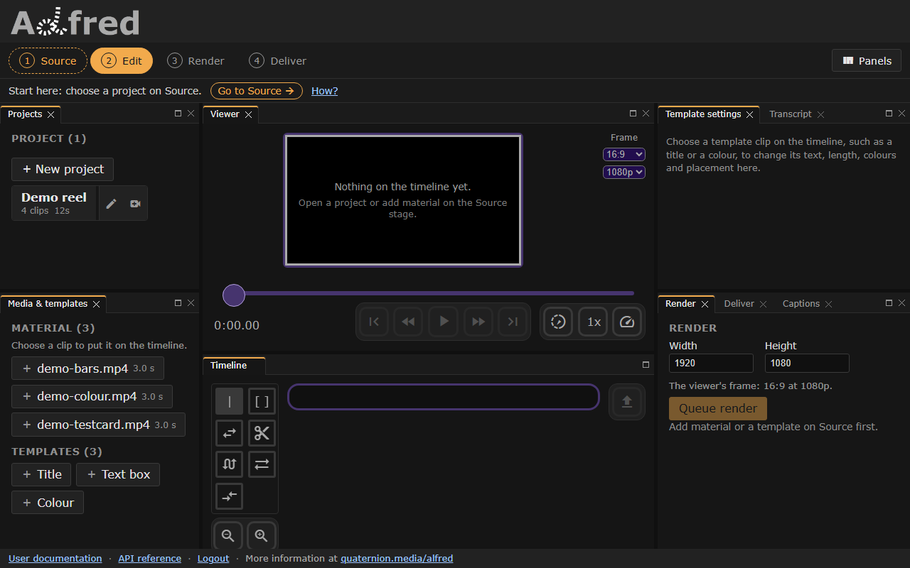

# Get started

The journey from a fresh clone to the editor answering on your own machine. No
cloud account is needed: the demo project and its media are made by the server
you run. From there, [the user journeys](journeys.md) make the first video.

## What you need

- **Docker**, with Compose (`docker compose`). The api, the render worker, the
  database and the site's build all run in containers.
- **git**, to clone with submodules. The two engines, otto and vox, are
  submodules, and the images do not build without them.
- **A POSIX shell** for `./al`, the repository's task runner, which is a `sh`
  script: on Windows, Git Bash or WSL.

[Commands on each system](commands.md) has the setup for Linux, macOS and
Windows, and every command beside its PowerShell form.

On Windows, a clone has one optional step more, for the instruction files that
are symlinks (`git config core.symlinks true`). `AGENTS.md`, at the root of the
repository, has it under "One-time setup on a fresh clone"; running the app does
not depend on it.

## Clone and start

```sh
git clone --recurse-submodules https://github.com/quaternionmedia/alfred.git
cd alfred
./al init
ALFRED_DEV_SKIP_AUTH=1 ./al dev
```

`./al init` builds the site's image and gives the checkout its own development
signing key, `.secret_key.local`, which git ignores. `./al dev` starts the dev
stack: the site, the api, a render worker and the database, building their
images the first time. `ALFRED_DEV_SKIP_AUTH=1` skips the login screen and
serves every request as a development superuser; [Skipping login in
development](dev-auth.md) says what that opens, and how to use a normal
account instead.

The app is published on port 1732, on this machine only. If something else
already holds the port, `./al dev` refuses to start and names it: start on
another with `ALFRED_PORT=1832 ./al dev`. The [dev-server notes](dev-server.md)
cover this and the other ports, and [Configuration](configuration.md#the-dev-stack-on-the-host)
lists them.

`./al stop` stops the stack.

## Open the app

Browse to <http://127.0.0.1:1732>.



*What a first visit shows: Source outlined, and the line under the rail saying where to start.*

It worked when the editor opens with the four stages on the rail, Source,
Edit, Render and Deliver, and the line under it says **Start here**. On a
screen 1024 pixels wide or more every panel is open at once; on a phone, one
stage at a time ([The editor in one look](journeys.md#the-editor-in-one-look)).

If the page does not load, or loads something else:

- **Another application answers.** Something else held 1732 first. `./al dev`
  refuses to start in that case and names it; `curl 127.0.0.1:1732/openapi.json`
  names whatever answers. Start clear of it with `ALFRED_PORT=1832 ./al dev`.
- **Every request is refused.** The api is crash-looping: `./al docker logs
  api` says why.
- **The login screen, every time.** The stack started without
  `ALFRED_DEV_SKIP_AUTH=1`: register an account on it ([An
  account](journeys.md#an-account)), or start it again with the bypass.

The [dev-server notes](dev-server.md) have the rest of what bites on a first
run.

## Next

- [A first video](journeys.md#first-video): Source to Deliver, in a few
  minutes, with nothing to bring.
- [Make a video with alfred and the QM family](guide.md): joe beside the
  stack, the sound transcribed, and a cut made by deleting words.
- [Questions a new developer asks](develop.md): to change alfred rather than
  use it.
