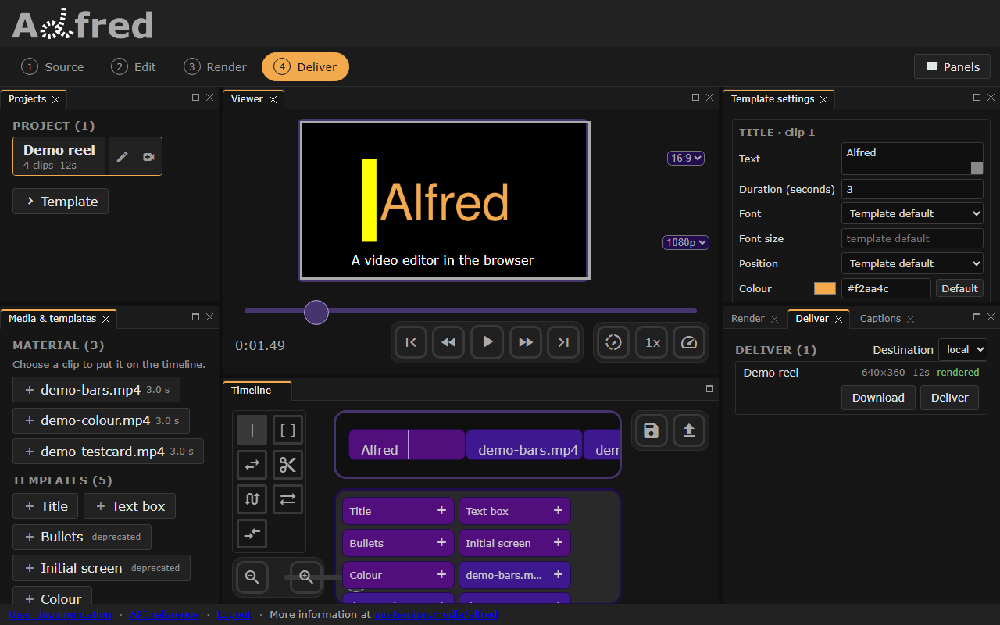

# Get started

This page runs Alfred on your own machine and makes a first video with it,
from a fresh clone to a file you can play. No cloud account is needed: the
demo project and its media are made by the server you run.

## What you need

- **Docker**, with Compose (`docker compose`). The api, the render worker, the
  database and the site's build all run in containers.
- **git**, to clone with submodules. The two engines, otto and vox, are
  submodules, and the images do not build without them.
- **A POSIX shell** for `./al`, the repository's task runner, which is a `sh`
  script: on Windows, Git Bash or WSL.

[Commands on each system](commands.md) has the setup for Linux, macOS and
Windows, and every command beside its PowerShell form.

On Windows, a clone has one optional step more, for the instruction files that
are symlinks (`git config core.symlinks true`). `AGENTS.md`, at the root of the
repository, has it under "One-time setup on a fresh clone"; running the app does
not depend on it.

## Clone and start

```sh
git clone --recurse-submodules https://github.com/quaternionmedia/alfred.git
cd alfred
./al init
ALFRED_DEV_SKIP_AUTH=1 ./al dev
```

`./al init` builds the site's image and gives the checkout its own development
signing key, `.secret_key.local`, which git ignores. `./al dev` starts the dev
stack: the site, the api, a render worker and the database, building their
images the first time. `ALFRED_DEV_SKIP_AUTH=1` skips the login screen and
serves every request as a development superuser; [Skipping login in
development](dev-auth.md) says what that opens, and how to use a normal
account instead.

The app is published on port 8000, on this machine only. If something else
already holds the port, `./al dev` refuses to start and names it: start on
another with `ALFRED_PORT=8100 ./al dev`. The [dev-server notes](dev-server.md)
cover this and the other ports, and [Configuration](configuration.md#settings)
lists them.

`./al stop` stops the stack.

## Open the app

Browse to <http://127.0.0.1:8000>. The editor opens at Edit, with the four
stages on the rail along the top: Source, Edit, Render and Deliver. On a screen
1024 pixels wide or more, every panel is open at once: the Source stage's two
panels on the left, the viewer over the timeline in the middle, and on the
right the selected clip's settings and the Transcript above the Render,
Deliver and Captions tabs.
Narrower, as on a phone, the editor shows one stage's panels at a time above
the viewer and the timeline.

## Make a first video

### 1. Source

Choose **Source** on the rail. The **Projects** panel lists the projects the
server seeds into an empty database; choose **Timeline demo**, three template
clips that need no media: a title, a text box and a colour field. If the list
is empty, as it is for a newly registered account, press **Generate a demo
project**, which makes the same three clips as a project called **Demo**.

The **Media & templates** panel lists the files in the server's library. On a
fresh install it has none, and **Generate demo media** makes three short clips
there (colour bars, a test card and a colour field), on the server, without the
network.

### 2. Edit


*The workspace at Edit, with a title chosen on the timeline and its settings on the right.*

Choosing a project opens it at Edit, its clips on the timeline from left to
right. Choose a clip and the playhead moves to it, and the viewer shows it: for a
template clip, a frame the server draws, and **Template settings** changes its
text, length, font and colour. Choose a file under **Material**, or a template under
**Templates**, to put it on the end of the timeline. The disk icon beside the
timeline saves the timeline to the project; a render takes the timeline as it
stands, saved or not.

### 3. Render


*The Render stage: the output's size, then Queue render.*

Choose **Render** on the rail. **Width** and **Height** start at the size the
project last rendered at, or else the viewer's; a smaller size, such as 640 by
360, makes a smaller file sooner. Press **Queue render**: the server queues the
render for its worker, and the editor moves to Deliver.

### 4. Deliver



*The Deliver stage: a finished render, with Download and Deliver.*

The **Deliver** panel lists the render as `queued`, then `rendering` with its
progress, then `rendered`. Once it is rendered, **Download** saves the video
through your browser, and **Deliver** sends it to the **Destination** above the
list: `local`, the one this server offers, copies it into the checkout's
`deliveries/` directory. If the panel says that no renderer is running, the
render stays queued until a worker starts; `./al dev` starts one with the stack.

## Where next

- [Cookbook](cookbook.md): the journeys through the editor, step by step,
  generated from the browser tests that check them.
- [Captions](captions.md): typing, importing and transcribing captions, drawing
  them into renders, and pointing Alfred at joe.
- [Commands on each system](commands.md): running, testing and looking, on
  Linux, macOS and Windows.
- [The test loop](loop.md): every suite side by side, and the app left up to
  try.
- [Configuration](configuration.md): every setting the server reads.
- [The family dev loop](family.md): alfred with otto, vox, joe and the rest,
  tested and run together.
- [Concepts](about/index.md): clips, templates, timelines, projects and
  renders.
- [Examples](examples/index.md) and the [API](api/index.md): making videos
  with the API directly, with `curl`. Your own server's interactive reference
  is at <http://127.0.0.1:8000/api>, linked from the editor's footer.
