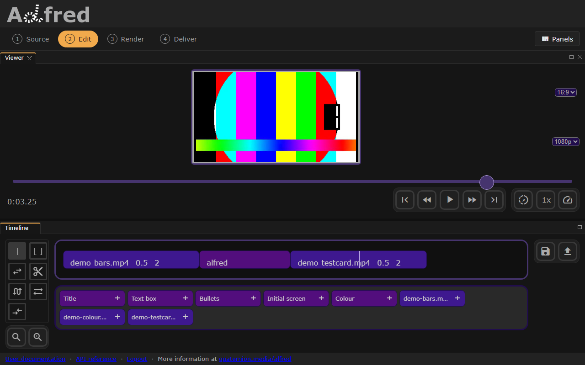
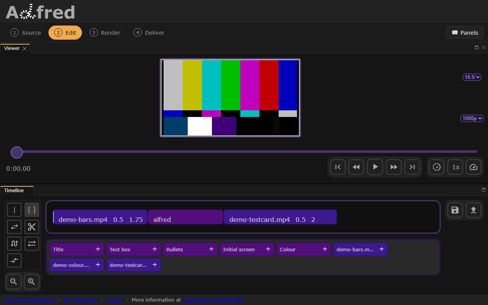
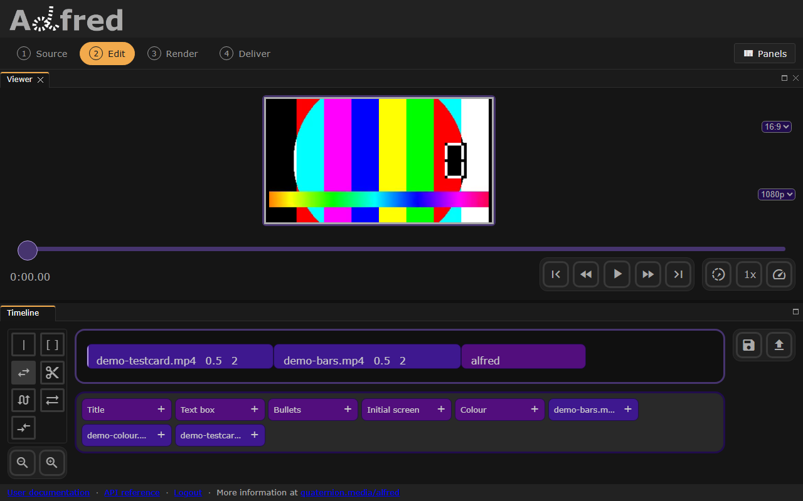
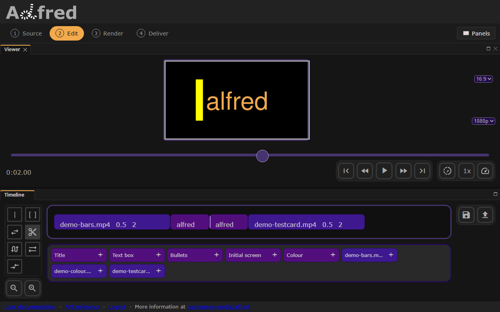
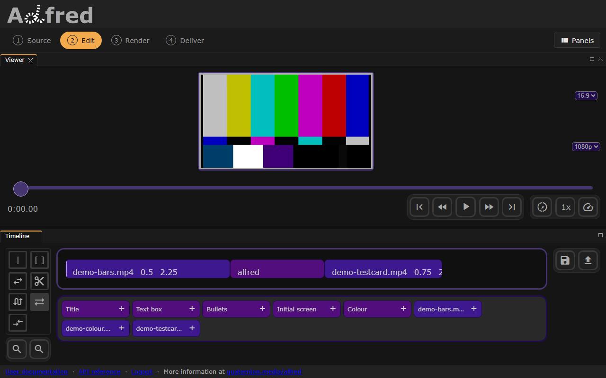
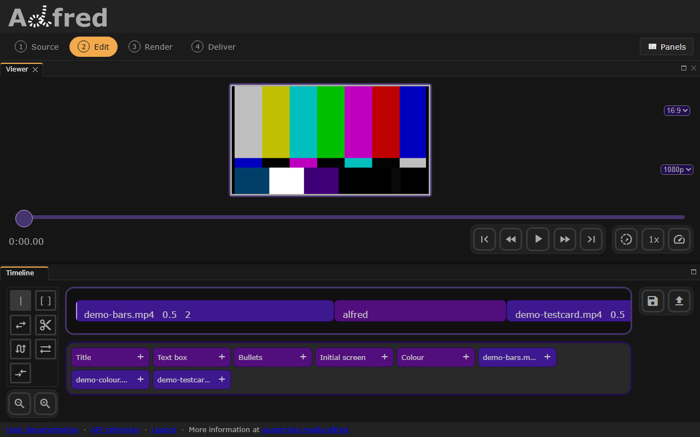

# Editing tools

The tools sit in a column beside the timeline on the Edit stage, with zoom below them. Choose one, then press or drag a clip. The tool chosen is drawn lit, and decides what a press on a clip does: move the playhead, split the clip, or begin a drag that changes it.

Each works by mouse and by touch. The four drags that change a clip -- trim, slip, slide and dual roller -- keep following the pointer after it leaves the clip, and a drag the browser takes back (to scroll, say) leaves the clips as they were. A tool that cannot act where it was pressed says why, rather than doing nothing.

## Keys

| Key | What it does, whichever tool is chosen |
| --- | --- |
| Tab, then Enter or Space | reach a tool and choose it: each tool is a button |
| S | split the clip under the playhead (see [Cut](#cut)) |
| ← and → | move the playhead 5 seconds back or on |
| Home and End | move the playhead to the start or the end |
| Space | play or pause, unless the keyboard has just moved to a button |

None of these is taken while you type in a field, a menu or the text of a template.

## The pictures

`./al recipes` takes each picture below from the running app (`website/e2e/screens-tools.spec.js`), so they show the tools as they behave. Each starts from the same project of demo media:

| Clip | What it plays |
| --- | --- |
| `demo-bars.mp4` | seconds 0.5 to 2 of the colour bars, which are 3 seconds long |
| `alfred` | a title, 1 second long |
| `demo-testcard.mp4` | seconds 0.5 to 2 of the test card, whose counter shows the second of the file |

The panels either side of the viewer and the timeline are closed, and the timeline is zoomed in three steps, so that each clip has room to show its label: its name, then its in-point and out-point in its file. The test makes the edit by mouse, checks the clips came out as described, and saves the page.

## Time

`|`, the *time selector*, chosen when the editor opens. It moves the playhead to where you press on a clip, and the viewer shows that frame.

- **Mouse:** click a clip at the point you want.
- **Touch:** tap it. A swipe across the timeline scrolls it and leaves the playhead where it was: only a press that stays put moves it.
- **Keys:** ← and →, Home and End move the playhead with any tool chosen.

*Time chosen and the test card pressed half way along: the playhead at 3.25 seconds, and the viewer on that frame of the card.*

## Trim

`[ ]`. It drags a clip's end: the clip gets longer or shorter, its out-point moves with it, and the clips after it move along. A media clip stops at the end of its file.

- **Mouse:** press the clip near its end and drag left or right.
- **Touch:** the same drag, with a finger.
- **Keys:** none of its own. A template clip's length can be typed instead, as its *Duration* beside the viewer.

*Trim chosen and the bars' end dragged a quarter of a second in: they now play 0.5 to 1.75 of their file, and the title and the test card have moved up behind them.*

## Move

The two arrows. It drags a clip to another place in the order; the timeline closes up behind it.

- **Mouse:** drag the clip and let go where it should go.
- **Touch:** the same drag, with a finger.
- **Keys:** none of its own.

*Move chosen and the test card dragged from the end to the front: test card, bars, title.*

## Cut

The scissors. It splits a clip in two where you press, and puts the playhead at the cut, on the second half. Either half can then be trimmed, moved or deleted on its own. A media clip becomes two windows onto its file that meet; the second half of a template carries on its animation from the cut, rather than starting it again.

- **Mouse:** click the clip where it should split.
- **Touch:** tap it there.
- **Keys:** S splits the clip under the playhead, whichever tool is chosen. Too close to the start or end of a clip, it does nothing and says so.

*Cut chosen and the title pressed at its middle: two half-second titles, the playhead at the cut, 2 seconds in.*

## Slip

It changes which part of its file a clip plays, keeping the clip's length and its place on the timeline. The picture follows the pointer: drag right for earlier material, left for later. It stops at the start and the end of the file. A template slips through its animation, but not before its start; a clip that already plays the whole of its file says there is nothing to slip.

- **Mouse:** drag the clip left or right.
- **Touch:** the same drag, with a finger.
- **Keys:** none of its own.

*Slip chosen and the test card dragged half a second left: it now plays 1 to 2.5 of its file, in the same place, and the viewer's counter has moved on.*

## Slide

It moves a clip along the timeline between its neighbours, which give and take the time. The clip keeps what it shows; the clip before it ends later or sooner, and the clip after it starts later or sooner in its file, so the timeline keeps its length. The first clip has nothing before it to slide against, and says so.

- **Mouse:** drag the clip left or right.
- **Touch:** the same drag, with a finger.
- **Keys:** none of its own.

*Slide chosen and the title dragged a quarter of a second later: the bars play on to 2.25, and the test card starts at 0.75 in its file.*

## Dual roller

It moves a cut: the clip before the cut ends where the clip after it now starts. Pressed on a clip's first half, it takes the cut at that clip's start; on its second half, the cut at its end. The cut moves only as far as both clips allow: no clip shorter than a tenth of a second, and none starting before its file does. A timeline of one clip has no cut to roll, and says so.

- **Mouse:** press near the cut and drag left or right.
- **Touch:** the same drag, with a finger.
- **Keys:** none of its own.

*Dual roller chosen and the cut between the title and the test card dragged half a second earlier: the title is half a second long, and the test card starts at 0 in its file.*

## Zoom

The magnifiers below the tools. Each press draws a second of the timeline narrower or wider; the edits are the same at any zoom, and the timeline scrolls once it is wider than its panel. In the workspace the two buttons zoom alone; in the phone layout, a bar between them can be dragged as well.

- **Mouse:** click zoom out or zoom in.
- **Touch:** tap them, or drag the bar on a phone.
- **Keys:** none of their own.

*Zoom in pressed four times from where the timeline opens: each second is drawn six times as wide, and the test card runs past the panel's edge.*
